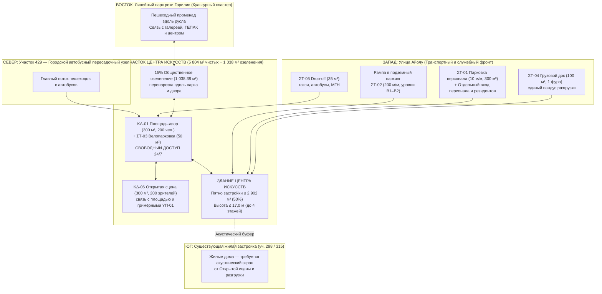
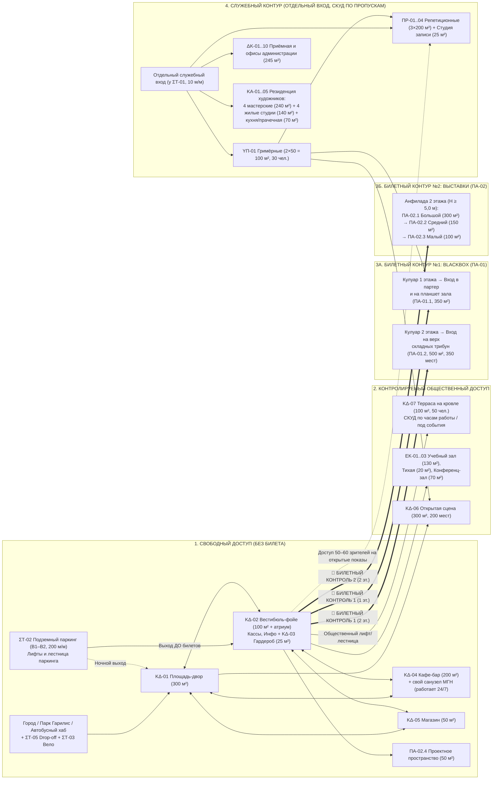
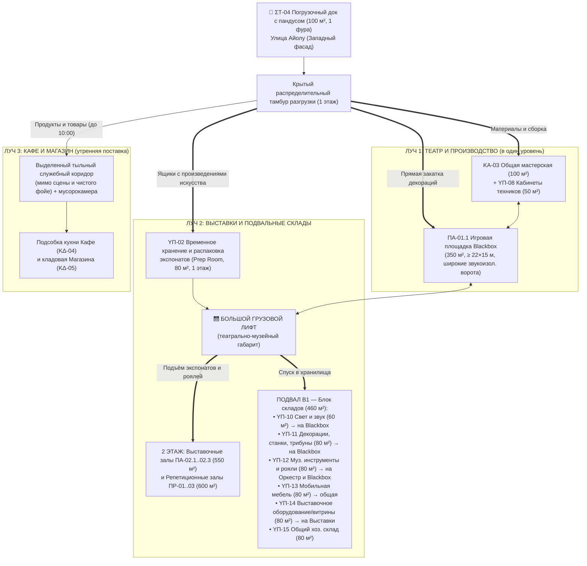

# Limassol Arts Centre (Тендер 77/26) — Выводы по ТЗ и архитектурно-технологические схемы

**Исполнитель проекта:** Мария Соломко (гр. Арх/б-22-2-о)  
**Карточка конкурса на сайте 2ВХУТЕМАС:** [Limassol Arts Centre, 2027 (ID 2670)](https://2vhutemas.ru/entities/limassol-arts-centre-2027) *(в разделе «Документы» опубликованы полные русские переводы Условий Part A и Программы помещений Appendix 1)*  
**Цифровая 3D-подоснова участка (Rhino):** [limassol-arts-centre-topo.3dm](../limassol/limassol-arts-centre-topo.3dm)

---

## 1. Паспорт задачи и жёсткие рамки участка

| Параметр | Значение по ТЗ | Что это значит для проекта |
|---|---|---|
| **Исходные участки (Католики, бывшая больница)** | Уч. `430` (4 687 м²) + `298` (1 240 м²) + `315` (1 255 м²) = **7 182,00 м²** | Сейчас плоскостная парковка с существующими рядами деревьев; рельеф плавно падает с СЗ (~31,4 м) на ЮВ к реке (~28,5 м) |
| **Обязательные отчуждения земли** | Дорожная сеть: **259,47 м²**; 15% общественного озеленения: **1 038,38 м²** | **Важно (п. 4.3 и 15.1 Part A):** схема нарезки из Приложения 6 — *не обязательна*! Мы вправе предложить **свою конфигурацию дороги и 15% зелёной зоны**, объединив зелень с парком реки Гарилис и двором |
| **Чистая площадь участка (Net Plot)** | **5 804,62 м²** (в таблицах) / **5 884,15 м²** (в тексте п. 4.3) | Расчёт ТЭП ведём от консервативной цифры **5 804,62 м²** |
| **Плотность застройки (FAR 1,40, зона `Κα3`)** | Макс. **8 126,47 м²** | Огромный запас: программа здания требует **4 015 м² полезной (NIA)** или **~5 420–6 022 м² общей (GBA)** |
| **Пятно застройки (Coverage 50%)** | Макс. **2 902,31 м²** | **Главный дефицит!** На 1-й этаж нельзя свалить все функции — нужна чёткая вертикальная поэтажная стратификация |
| **Макс. высота и этажность (`Κα3`)** | **17,0 м** и **4 этажа** | **Главная коллизия разреза:** Blackbox требует чистой высоты **≥ 15,0 м до точек подвеса** (+ 2,5–3,0 м на грид и фермы = ~18 м). Решается притапливанием планшета сцены/зала на 1,5–2,5 м! |
| **Сметный бюджет** | **25 500 000 €** (без НДС) | Превышение более чем на 10% лишает права на 1–3 премии (п. 15.2) |
| **Сроки конкурса** | Подача: **22.03.2027 до 12:00** | Сдаются: макет М 1:500 на подрамнике А2, до 10 планшетов А1, альбом схем площадей А3 (М 1:200), записка А4 (≤ 2000 слов), видеопроход MP4/MOV |

---

## 2. Генеральный план: 4 стороны участка и посадка объёма

Участок зажат между четырьмя принципиально разными градостроительными фронтами:
1. **ВОСТОК — Линейный парк реки Гарилис (Ватья):** главный общественный, пешеходный и зелёный фасад. Связывает наш центр с культурным кластером Лимасола (кинотеатр «Таксим», Муниципальная галерея, павильон Полидоридиса, кампус ТЕПАК). Сюда раскрываются **15% общественного озеленения (1 038 м²)**, **Площадь-двор (`ΚΔ-01`, 300 м²)**, **Кафе (`ΚΔ-04`)** и **Открытая сцена (`ΚΔ-06`, 300 м²)**.
2. **СЕВЕР — Участок 429 (будущий центральный автобусный пересадочный хаб):** главный поток пешеходов из города, но одновременно источник транспортного шума и вибраций. Со стороны севера формируем активный пешеходный вход на Площадь-двор, но защищаем акустически чувствительные залы.
3. **ЗАПАД — Улица Айолу (`Aiolou St.`):** главный транспортный и хозяйственный фронт. Здесь размещаем:
   * Полосу кратковременной высадки / Drop-off (`ΣΤ-05`, 35 м²) ближе к входу;
   * Рампу въезда/выезда в 2-уровневый подземный паркинг (`ΣΤ-02`, 200 м/м);
   * Погрузочный док для фуры (`ΣΤ-04`, 100 м²) с разворотной площадкой;
   * Служебную стоянку персонала (`ΣΤ-01`, 10 м/м = 300 м²) и отдельный **Служебный вход (Stage Door / Staff Entrance)**.
4. **ЮГ — Плотная жилая застройка (вплотную к узким участкам 298 и 315):** уязвимая по шуму зона. Открытую сцену (`ΚΔ-06`) и грузовой двор (`ΣΤ-04`) необходимо экранировать от южных жилых домов объёмом здания или акустическими буферами.

### Схема генерального плана и внешних потоков

---

## 3. СКУД (система контроля доступа) и разведение потоков

Главное планировочное решение — **разделение комплекса на «Свободное городское ядро» (без билетов) и 3 контролируемых контура** (2 билетных + 1 служебно-резидентский по ключ-картам).

### Принятые правила доступа по зонам:
1. **Свободная зона (БЕЗ БИЛЕТА, открыта весь день и работает автономно вечером/ночью):**
   * **Площадь-двор (`ΚΔ-01`, 300 м²)** + **Велопарковка (`ΣΤ-03`)** + **Полоса высадки (`ΣΤ-05`)**.
   * **Выход людей из подземного паркинга (`ΣΤ-02`, 200 м/м на `B1–B2`):** пассажирские лифты и лестница паркинга поднимают посетителей **в свободную зону главного вестибюля (`ΚΔ-02`) / тамбур Площади-двора ДО линии билетного контроля**. Когда основное здание закрыто, двери в фойе блокируются, и тамбур лифта паркинга работает напрямую на Площадь-двор и Кафе. *(Эвакуационные лестницы паркинга по пожарным нормам выходят непосредственно наружу).*
   * **Главный вестибюль-фойе (`ΚΔ-02`, 100 м² + рекреации)** с кассами, стойкой информации и гардеробом (`ΚΔ-03`, 25 м²).
   * **Кафе-бар (`ΚΔ-04`, 200 м², 80 мест)** и **Магазин (`ΚΔ-05`, 50 м², 30 чел.):** стоят на границе между Площадью-двором и Вестибюлем, имеют **двусторонний вход (с площади и из фойе)** и свой выделенный санузел МГН (`ΥΠ-03`), чтобы работать ночью и вне часов работы центра.
2. **Общественная зона с контролируемым режимом (без билета в театр, но под контролем СКУД/расписания):**
   * **Терраса на кровле (`ΚΔ-07`, 100 м², 50 чел.):** по ТЗ имеет *«контролируемый доступ»*. Доступна из свободного вестибюля `ΚΔ-02` по главному общественному лифту и лестнице; перед выходом на кровлю — электрозамок СКУД (открыта днём для обзора, запирается на ночь и во время закрытых мероприятий).
   * **Учебный и исследовательский блок (`ΕΚ-01` Зал занятий 130 м², `ΕΚ-02` Тихая комната 20 м², `ΕΚ-03` Конференц-зал 70 м² = 220 м²):** вход из свободного вестибюля через лёгкий контроль/ресепшн.
   * **Проектное пространство (`ΠΑ-02.4`, 50 м²):** по ТЗ не требует обязательной сцепки с остальными залами выставок — его выгодно поставить у свободного фойе как бесплатную «выставочную витрину».
3. **Билетный контур № 1 — Blackbox (`ΠΑ-01`, 850 м², ≥ 350 зрителей):**
   * Контроль билетов на входах в **двухъярусное фойе-кулуары зала**:
     * **1 этаж (уровень планшета):** нижний вход зрителей в партер / при плоской рассадке;
     * **2 этаж (уровень балкона `+3.600…+4.200`):** верхний вход зрителей на разложенные складные трибуны (`ΠΑ-01.2`).
4. **Билетный контур № 2 — Выставочные залы (`ΠΑ-02.1`…`02.3`, 550 м², 150 посетителей):**
   * Единая гибкая анфилада на **2-м этаже** (Большой зал 300 м² + Средний 150 м² + Малый 100 м², чистая высота ≥ 5,0 м). Контроль билетов — на входе с верхнего уровня фойе.
5. **Служебно-производственный и резидентский контур (по пропускам, ОТДЕЛЬНЫЙ ВХОД С УЛИЦЫ):**
   * По ТЗ и **Администрация (`ΔΚ-01`…`10`, 245 м²)**, и **Резиденция художников (`ΚΑ-01`…`05`, 450 м²)** обязаны иметь **отдельный контролируемый вход с улицы (НЕ через зрительское фойе!)** рядом со стоянкой персонала (`ΣΤ-01`).
   * Этот же служебный вход (`Stage Door`) ведёт артистов в **Гримёрные (`ΥΠ-01`, 2 × 50 = 100 м²)** и **Репетиционные залы (`ΠΡ-01`…`04`, 625 м²)**.
   * *Режим открытых репетиций (`work-in-progress`):* когда в репетиционных залах (`ΠΡ-01` Танец, `ΠΡ-02` Театр, `ΠΡ-03` Оркестр) проводится показ для 50–60 зрителей, зрители поднимаются туда по общественной лестнице/лифту из фойе, не попадая в коридор гримёрных и жилых студий резидентов.

### Диаграмма СКУД и движения посетителей / персонала

---

## 4. Технология сцены Blackbox, гримёрных и единого узла загрузки

### 4.1. Устройство Blackbox (`ΠΑ-01`, 850 м²) и решение высотного конфликта
* **Габариты:** единый прямоугольный бокс площадью **850 м²** (при минимальной ширине игровой площадки **22,0 м** полная длина зала составляет **~38,5 м**: `22 × 15 м = 330–350 м²` игровая площадка `ΠΑ-01.1` + `22 × 22,7 м = 500 м²` зона выдвижных трибун `ΠΑ-01.2` на ≥ 350 мест).
* **Без колосниковой башни (`no fly tower`):** над всей площадью 850 м² на высоте **≥ 15,0 м в чистоте от пола** подвешивается сплошной технический грид (`full-ceiling tension wire grid / catwalks`) с точечными лебёдками (`point hoists` по EN 17206), дорожками чёрного кабинета и фермами постановочного света/звука/проекции. Это позволяет поворачивать схему «сцена — зал» в любую сторону (фронтально, торцевой `thrust`, «арена» в центре, плоский пол).
* **Как уложить 15 м чистой высоты в градостроительный лимит 17,0 м:**
  * Над отметкой подвеса +15,0 м нужно минимум **2,5–3,0 м** на сам грид, большепролётные балки/фермы (пролёт 22 м), звукоизолирующую плиту покрытия и воздуховоды (итого **17,5–18,0 м**).
  * **Решение:** опускаем планшет Blackbox (`ΠΑ-01.1` / `ΠΑ-01.2`) и примыкающий пандус разгрузки (`ΣΤ-04`) на **1,5–2,0 м ниже отметки земли** (или сажаем зал в юго-восточной/центральной части с использованием естественного уклона рельефа с 31,4 м до 28,8 м). Тогда:
    1. Верх парапета крыши Blackbox чётко вписывается в законные **≤ 17,0 м**;
    2. Из Вестибюля (`0.000`) зрители спускаются на полэтажа в партер (`-1.500…-1.800`) или поднимаются на полэтажа-этаж (`+2.400…+3.000`) на верхнюю площадку трибун!
* **Хранение трибун, станков и декораций:**
  * Основная телескопическая трибуна на 350 мест складывается «гармошкой» в пристенную нишу глубиной ~1,8 м прямо в торце зала под балконом 2-го этажа.
  * Для дополнительных боковых трибун, станков/подиумов, кулис (`ΥΠ-11`, 80 м²), светозвукового оборудования (`ΥΠ-10`, 60 м²) и роялей/инструментов (`ΥΠ-12`, 80 м²), которые по таблице ТЗ лежат в подвале `B1`, предусматриваем **крупногабаритный театральный грузовой лифт (например, 3,0 × 6,0 м)** непосредственно у ворот сцены и разгрузки.

### 4.2. Как работают Гримёрные (`ΥΠ-01`), Распаковочная (`ΥΠ-02`), Мастерская (`ΚΑ-03`) и Загрузка (`ΣΤ-04`)
* **Гримёрные (`ΥΠ-01`, 2 × 50 = 100 м² на 30 человек)** работают **ТОЛЬКО на сценический и репетиционный комплекс** (не на выставки):
  * Имеют прямой выход на сцену **Blackbox (`ΠΑ-01.1`)**;
  * Имеют прямой выход на уличную **Открытую сцену (`ΚΔ-06`)**;
  * Связаны служебной лестницей/лифтом с **Репетиционными залами (`ΠΡ-01` Танец, `ΠΡ-02` Театр, `ΠΡ-03` Оркестр)**.
* **Временное хранилище и подготовка экспонатов (`ΥΠ-02`, Prep Room, 80 м²)** работает **СПЕЦИАЛЬНО на Выставочные залы (`ΠΑ-02`)**:
  * Принимает ящики с картинами и скульптурами с дебаркадера `ΣΤ-04` на 1-м этаже и через **Большой грузовой лифт** подаёт их на 2-й этаж в анфиладу выставок (`ΠΑ-02.1`…`02.3`), а пустые кофры и витрины опускает в подвальный склад выставок **`ΥΠ-14` (80 м² в `B1`)**.
* **Общая мастерская (`ΚΑ-03`, General Workshop, 100 м²)** работает **НА ВСЕХ**:
  * Стоит на 1-м этаже вплотную к разгрузке `ΣΤ-04` и сцене `ΠΑ-01.1`; обслуживает сборку/ремонт декораций Blackbox, крупных выставочных инсталляций и работ художников-резидентов (`ΚΑ-01`).
* **Загрузка Кафе (`ΚΔ-04`) и Магазина (`ΚΔ-05`):**
  * Использует **тот же грузовой двор/пандус `ΣΤ-04`** (или утреннюю остановку фургона на полосе `ΣΤ-05`), но идёт по **отдельному служебному коридору в обход сцены и зрительского фойе** прямо в подсобку кухни Кафе (соблюдение нормы `EN 16282` о разделении чистых и грязных потоков).

### Схема единого узла разгрузки (`ΣΤ-04`) и грузовых потоков

---

## 5. Поэтажная схема здания (вертикальный разрез и баланс площадей)

Такая раскладка позволяет **уложиться в пятно застройки ≤ 2 902 м² (50%)**, соблюсти **высоту ≤ 17,0 м** и развести все потоки:

| Уровень | Что размещается на этаже | Полезная площадь (NIA), м² | Ориентировочная общая (GBA ×1,35), м² | Примечание по потокам и высоте |
|---|---|---|---|---|
| **Кровля (`+13.500…+17.000`)** | `ΚΔ-07` Терраса на кровле (100 м², открытая) + верх объёма Blackbox | *(100 м² снаружи)* | — | Контролируемый доступ из общественного ядра фойе |
| **3–4 этажи (`+8.400…+13.500`)** | **Репетиционные:** `ΠΡ-01` Танец (200 м², H≥7 м), `ΠΡ-02` Театр (200 м²), `ΠΡ-03` Оркестр (200 м², H≥5 м) + `ΠΡ-04` Студия записи (25 м²) **Администрация:** `ΔΚ-01`…`10` (245 м²) **Резиденция художников:** `ΚΑ-01` (4×60=240 м²), `ΚΑ-02` (4×35=140 м²), `ΚΑ-04` Кухня (60 м²), `ΚΑ-05` Прачечная (10 м²) Санузлы `ΥΠ-03` (60 м²) | **1 380 м²** | **~1 863 м²** *(разбито на 2 этажа по ~930 м²)* | Отдельный вход и лифт персонала/резидентов; на открытые показы в `ΠΡ-01..03` зрители (50–60 чел.) заходят с общественного ядра |
| **2 этаж (`+4.200`)** | **Выставочная анфилада (H ≥ 5,0 м):** `ΠΑ-02.1` Большой (300 м²) + `ΠΑ-02.2` Средний (150 м²) + `ΠΑ-02.3` Малый (100 м²) = 550 м² **Образование:** `ΕΚ-01` Зал занятий (130 м²), `ΕΚ-02` Тихая (20 м²), `ΕΚ-03` Конференц-зал (70 м²) = 220 м² **Верхний вход на трибуны Blackbox** + **Аппаратные:** `ΥΠ-04` Звук (30 м²), `ΥΠ-05` Видео (30 м²), `ΥΠ-06` Свет (30 м²), `ΥΠ-07` Перевод (20 м²) = 110 м² Санузлы `ΥΠ-03` (60 м²) | **940 м²** *(+ второй свет Blackbox 850 м²)* | **~1 270 м²** *(в габарите пятна с учётом двусветного Blackbox ~2 400 м²)* | Верхнее фойе делит потоки: налево по билетам — верх трибун Blackbox, направо по билетам — Выставки, прямо без билета — Учебный блок |
| **1 этаж (`0.000` / планшет Blackbox `-1.500`)** | **Blackbox:** `ΠΑ-01.1` Сцена (350 м²) + `ΠΑ-01.2` Зал/трибуны (500 м²) = 850 м² (чистая высота ≥ 15 м до грида) **Свободный вход:** `ΚΔ-02` Вестибюль-фойе (100 м²), `ΚΔ-03` Гардероб (25 м²), `ΚΔ-04` Кафе (200 м²), `ΚΔ-05` Магазин (50 м²), `ΠΑ-02.4` Project Space (50 м²) **Артисты и загрузка:** `ΥΠ-01` Гримёрные (100 м²), `ΚΑ-03` Общая мастерская (100 м²), `ΥΠ-02` Распаковка выставок (80 м²), `ΥΠ-08` Кабинеты техников (50 м²), `ΥΠ-09` Управляющий (10 м²) Санузлы `ΥΠ-03` (80 м², вкл. ночной туалет кафе) | **1 695 м²** | **~2 288 м²** *(габарит пятна 1 этажа **≤ 2 902 м²** выдержан с запасом ~600 м² под портики и атриум!)* | Снаружи на уровне земли: `ΚΔ-01` Площадь-двор (300 м²), `ΚΔ-06` Открытая сцена (300 м²), `ΣΤ-04` Грузовой док (100 м²), `ΣΤ-05` Drop-off (35 м²), `ΣΤ-03` Вело (50 м²), `ΣΤ-01` Парковка персонала (300 м²) |
| **Подвал `B1` (`-3.500`) и `B2` (`-6.500`)** | **Склады и MEP (`B1`):** `ΥΠ-10` Свет/звук (60 м²), `ΥΠ-11` Декорации/станки (80 м²), `ΥΠ-12` Муз. инструменты (80 м²), `ΥΠ-13` Мебель (80 м²), `ΥΠ-14` Выставки (80 м²), `ΥΠ-15` Общий склад (80 м²), `ΥΠ-16` Инженерная (50 м²) = **510 м²** **Паркинг посетителей (`B1–B2`):** `ΣΤ-02` 200 м/м × 30 м² = **6 000 м²** (по ~3 000 м² на этаж) | *(510 м² склады + 6 000 м² паркинг — вне NIA)* | *(не входит в расчёт FAR 5 420 м²)* | Выход посетителей из лифтов паркинга — в свободную зону `ΚΔ-02` / `ΚΔ-01` ДО билетного контроля |
| **ИТОГО ЗДАНИЕ** | **Все 58 позиций программы соблюдены 1:1** | **4 015 м² NIA** | **5 420,25 м² GBA** | Полное соответствие ТЗ |

---

## 6. Чек-лист первых шагов для Марии Соломко

1. **Проверить 3D-подоснову в Rhino (`limassol-arts-centre-topo.3dm`):**
   * Нанести границу вычета дороги (259,47 м²) и предложить **нашу конфигурацию 15% общественного озеленения (1 038,38 м²)** вдоль восточной границы (к линейному парку реки Гарилис) и южного жилого торца.
2. **Собрать блок-схему (massing) в М 1:500 на участке 5 804 м²:**
   * Проверить пятно застройки 1-го этажа (**≤ 2 902 м²**, фактически ~2 300–2 500 м²);
   * Посадить ядро **Blackbox (22 × 38,5 м, высота в чистоте 15 м)** с притапливанием планшета на ~1,5–2,0 м, чтобы верх крыши не превысил отметку **+17,0 м**;
   * Развернуть **Площадь-двор (`ΚΔ-01`, 300 м²)** и **Открытую сцену (`ΚΔ-06`, 300 м²)** к парку Гарилис и северному пешеходному подходу (от будущего автобусного узла на уч. 429), прикрыв южных соседей от шума сцены.
3. **Отрисовать поэтажные схемы функционального зонирования и СКУД (1 этаж, 2 этаж, 3–4 этажи, разрез по Blackbox и паркингу `B1–B2`):**
   * Показать двухуровневую загрузку зрителей в Blackbox (1 этаж — партер, 2 этаж — верх складных трибун);
   * Показать единый грузовой узел на западном фасаде (ул. Айолу): `ΣΤ-04` Док -> прямая накатка на сцену `ΠΑ-01.1`, в мастерскую `ΚΑ-03` и через распаковочную `ΥΠ-02` + большой грузовой лифт на выставки 2-го этажа и в склады `B1`.
