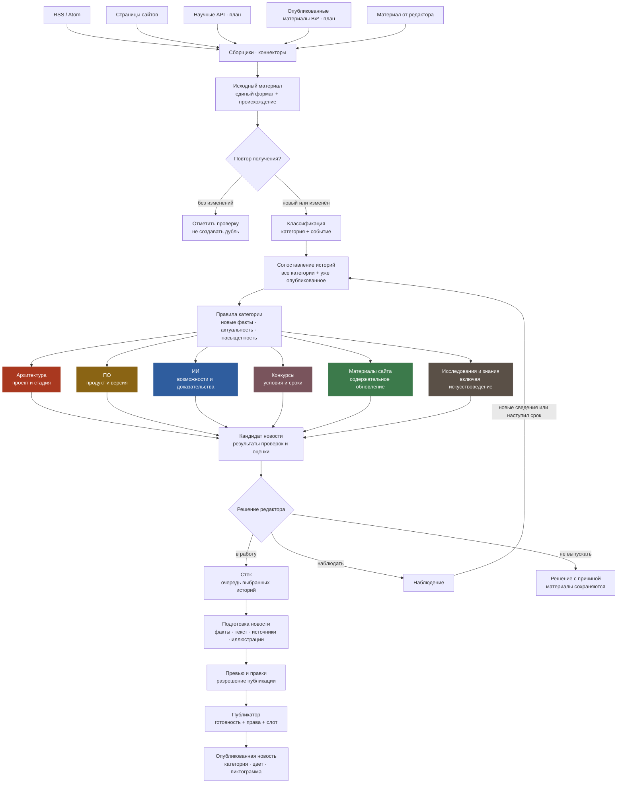

# Новости — схема конвейера и план внедрения

По поручению пользователя: «Давай сделаем диаграмму от сборщиков к новости, чтобы закрепить термины и подготовить план имплементации». Это целевой процесс, не описание уже работающего сервера. Шесть категорий, оформление и таблица категорий утверждены ранее. Индивидуальные алгоритмы, пороги и физическое хранение промежуточных данных требуют проектирования; диаграмма не разрешает дополнительные таблицы помимо ранее согласованных.

Искусствоведение — полноценное направление «Исследований и знаний»: история и теория искусства, история дизайна и визуальная культура, наследие и реставрация. Новизна здесь включает атрибуцию, архивный документ, обоснованную интерпретацию, а не только эксперимент. Седьмая категория не появляется.

## Основной путь

Шесть цветных ветвей показывают разную профильную оценку, а не шесть одновременно запускаемых обработок одной истории. У истории один основной маршрут. Сначала общий поиск совпадений, затем правила категории определяют существенность нового и актуальность. Пустая ветвь или низкий приоритет не создают обязанности заполнить слот.

API OpenAlex/Crossref — кандидаты на подключение, не действующие сборщики. ResearchGate пока остаётся каналом редакторского обнаружения работ, не прямым автоматическим коннектором. Основания и ограничения — в [инвентаризации](Новости%20—%20источники%20и%20формальный%20сбор.md).

## Термины

| Термин | Точное значение | Что не следует смешивать |
|---|---|---|
| Источник | Издание, официальный сайт, научный каталог или внутренний источник событий | Источник не определяет категорию каждой публикации жёстко |
| Коннектор / сборщик | Адаптер получения материалов: RSS, HTML, API, внутреннее событие, редакторский ввод | Категория не требует собственного способа скачивания |
| Исходный материал | Конкретная публикация источника в едином формате, с исходником и происхождением полей | Это ещё не новость нашего сайта |
| Классификация | Назначение одной основной категории и описание события; правило или LLM с контекстом источника | Не оценка вкуса и не автоматическое одобрение |
| Категория | Один из шести маршрутов и его оформление; ссылка по UID на news_categories | Тип сущности результата остаётся «Новость»; жанр — отдельный признак |
| Событие | Что произошло: релиз версии, открытие объекта, объявление конкурса, новая атрибуция | Объект или общая тема сами по себе не являются событием |
| История | Событие или его развивающийся сюжет, объединяющий материалы нескольких источников | Несколько перепечаток не равны нескольким независимым подтверждениям |
| Новые сведения | Существенная разница с фактами уже известной истории | Свежая дата перепечатки не доказывает новизну |
| Актуальность | Значение события сейчас по правилам категории | Не единый штраф за возраст публикации |
| Насыщенность | Сколько близких тем редакция недавно рассматривала или выпускала | Не тождественна дублю события; влияет на приоритет |
| Кандидат новости | История с предлагаемой категорией, источниками, результатами проверок и доводами | Не готовый текст и не запись в очереди публикации |
| Наблюдение | Сохранённая история, ожидающая сведений или контрольного срока | Не отказ и не обещание публикации |
| Стек | Редакционная очередь выбранных историй для подготовки и выхода | «В стек» не равно «опубликовать автоматически» |
| Новость | Редакционный материал типа «Новость»: сначала черновик, затем опубликованная версия | Категория и визуальные атрибуты не заменяют состояние публикации |

Это логические роли в процессе, не перечень новых таблиц. Все внутренние связи — UID. DOI, URL, arXiv ID и другие внешние идентификаторы помогают сопоставлению, но не подменяют внутренние UID.

## Контракты и исключения

1. **На входе:** UID источника, внешние идентификаторы, canonical URL, заголовок, язык, анонс/текст, полнота текста, даты публикации/изменения/получения, иллюстрации и авторство, отпечаток содержания, происхождение полей. Неизвестная дата сохраняется неизвестной. Изменившийся документ по прежнему URL обрабатывается повторно как версия исходного материала.
2. **Классификатор:** выдаёт UID категории, событие, основание и уверенность. Категорию проверяет сервер. Если текста недостаточно — получение дополнительного текста; если маршрут неясен — разбор редактором. «Требует разбора» — состояние, не седьмая категория.
3. **Общие проверки:** точные совпадения по идентификаторам/отпечаткам; поиск похожих историй по всем категориям и опубликованным новостям; сравнение фактов. Векторы дают кандидатов для сопоставления, не окончательное решение о дубле. Повтор без новых фактов добавляет источник к существующей истории, не новый кандидат.
4. **Результат правил категории:** новое событие / новые сведения / дополнительный источник / неактуально / недостаточно данных; отдельно — насыщенность и причины. Для знаний метод проверки включает работу с документами, атрибуциями и аргументами; препринт и рецензируемая статья различаются. Исследования ИИ идут в ИИ.
5. **Профильная оценка:** архитектура — выборка и новое в проекте; ПО — изменение рабочих возможностей; ИИ — значение, доказательства и динамика; конкурсы — условия и сроки; сайт — содержательность публикации; знания — основания, новизна вывода, ценность для обучения. Профиль редакторского вкуса применяется там, где нужен, а не ко всем категориям обязательно.
6. **До выпуска:** выбранные источники дочитываются, факты отделяются от мнения, права и авторство сохраняются. Недоступный полный текст не подменяется догадками; проблема видна редактору. Превью относится к той же редакции, которая будет опубликована; перегенерация не должна оставить в БД прежний текст или затереть ручные правки.
7. **Идемпотентность:** повтор задания не создаёт повторный материал/кандидат/черновик. Одна история может получить новое содержательное развитие или новую редакцию; это не повод клонировать запись при каждом обходе.
8. **Внутренний коннектор:** реагирует на опубликованные содержательные изменения. Созданные самим роботом новости исключаются из входных событий, чтобы публикация анонса не запускала бесконечную цепочку анонсов.
9. **Сбои:** ошибки сбора, LLM и API сохраняют исходник, причину, идентификатор прогона и возможность повтора; ошибку нельзя превращать в редакторское «нет». Общие права, аудит, резервирование и наблюдение за состоянием действуют с первого этапа.

## Порядок реализации

| Этап | Что делаем | Существующая опора | Критерий завершения |
|---|---|---|---|
| 0. Фактическое состояние | Сверить серверный код, cron, источники и added_sources, прогоны, профиль и очередь. Снять набор для проверки с материалами всех доступных категорий | run.py, sources.yaml, .state, out, WIKI | Отделены локальные изменения от выложенных; зафиксированы реальные источники и исходные показатели; нет выдуманных свежих данных |
| 1. Основа и категории | Реализовать ранее согласованный справочник, права, аудит, категории в версиях новости; выбрать хранение исходников и соответствие UID источников. Подготовить и проверить BackUp | Проект news_categories, entities/revisions, уже согласованный проект news_sources, BackUp | Новая схема проходит миграцию и проверку восстановления на изолированном наборе; старые новости и оценки сохранены; связь только по UID; гостю нельзя изменять справочник |
| 2. Единый вход | Выделить контракт коннектора, адаптировать RSS/HTML, сохранять исходники до LLM; повтор получения и изменение содержимого | feeds.py, lists.py, fetch.py, state.py, pool.py | Повторный обход не создаёт дубли; изменение по старому URL обнаруживается; сбой LLM не теряет полученный материал |
| 3. Категория и история | Разделить классификацию и оценку, общее сопоставление историй, ручной разбор, объяснимые результаты проверок | pipeline.triage, similar.py, prompts/triage.md | Изменение вкуса не меняет фактическую классификацию; новый этап проекта не склеивается с прежним событием; пересказ из другого издания присоединяется к истории |
| 4. Шесть правил обработки | Отдельные критерии новизны, актуальности, насыщенности и оценки; начать с архитектуры, затем ПО, ИИ, конкурсов, сайта, знаний. Добавить внутренний коннектор и научные API после проверки условий; собрать источники искусствоведения | pipeline.rank, learn.py, resonance.py; источники требуют пополнения | На примерах проверены перенос дедлайна, новая версия ПО, независимая проверка ИИ, открытие здания, обновление лекции, новая атрибуция; каждая ветвь объясняет решение |
| 5. Редактор и выпуск | Выборки по категориям, единые цвета/пиктограммы, наблюдение и стек; подготовка, превью, синхронизация черновика, публикация | NewsRobot.tsx, newsRobot.ts, prepare.py, publish.py, news.ts | Редактор видит причины; правки не теряются; публикуется согласованная версия; снятие со стека не оставляет необработанного черновика; источники и фильтр категорий работают |
| 6. Сравнение и переключение | Сначала обработка копии исходников без публикации и изменения боевой очереди; затем включение по категориям | Отчёты прогонов, smoke.sh, сценарии браузера | Сверены повторы, пропуски, неоднозначные категории, расходы LLM и задержки; при сбое отключается новый путь без удаления данных; применение и результаты реально проверены |

Этапы 0–6 — порядок этой задачи, не замена пользовательских четырёх этапов интерфейсов. Их таблица не меняется. Новые промежуточные таблицы не вводятся автоматически: решение о хранении готовится на этапе 1 в рамках правил модели данных. Формальные лимиты качества задаются после исходного замера, не выдумываются заранее.

## Отличия от текущей реализации и границы решения

- Сейчас общий triage совмещает классификацию с предпочтениями; общий rank оценивает все темы; единых шести маршрутов нет. План разделяет эти ответственности.
- Сейчас лучшие истории могут получать полный текст до редакторского выбора. На диаграмме показана **предлагаемая** подготовка после попадания в стек; отключение прежней предварительной генерации требует согласования до изменения этого поведения. Получение первоисточника для классификации/проверки может происходить раньше и не является генерацией новости.
- Конкретный новый интерфейс разрешения публикации не утверждён: на схеме показана обязательная проверка готовности и действующего права publish, без изобретения нового обязательного согласующего лица. Слоты и правила выхода Р-119/Р-121 сохраняются.
- Старые оценки и параметры обучения не обнуляются. Нельзя переносить отрицательные оценки «старое/уже было» в запрет всей темы. Соотношение старого news_topic и новой категории описано в проекте справочника.
- Н-01…Н-07 из ревизии ARGON проверяются перед выпуском: новый конвейер сам по себе не исправляет синхронизацию текста, источники и снятие со стека.
- На этой итерации сделаны только документация и диаграмма. Подключение источников, миграция, BackUp, изменение расписания и выкладка не выполнялись.

Основания: [категории и таблица](Новости%20—%20отдельные%20конвейеры.md), [источники и формальный сбор](Новости%20—%20источники%20и%20формальный%20сбор.md), [робот и промпты](Новости%20—%20робот,%20цепочка%20и%20промпты.md), [общий план](План%20реализации.md).
