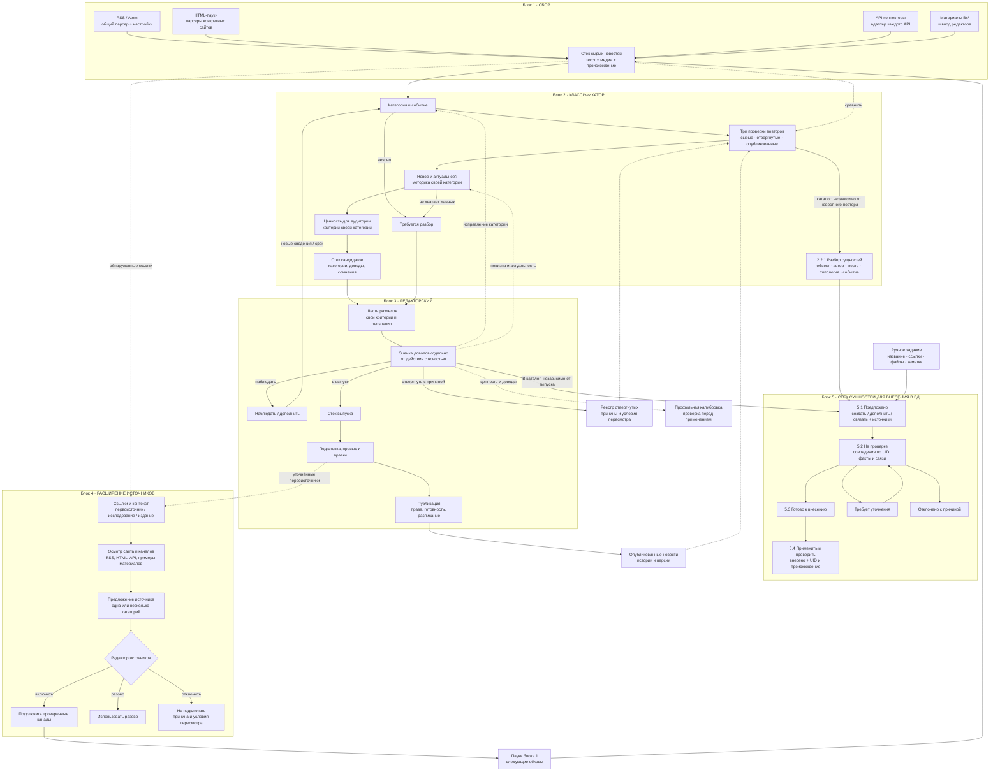

# Новости — три блока обработки

Пользователь уточнил целевой процесс: несколько пауков → исходные материалы с медиа → стек сырых новостей; классификатор с проверкой повторов в сырых, отвергнутых и опубликованных, актуальность по типам → стек кандидатов; редакторский блок по типам с содержательной обратной связью вместо обучения только на «ДА / НЕТ / В СТЕК».

Это действующее структурное уточнение схемы. Шесть категорий и их оформление сохраняются. Здесь «тип» означает категорию обработки, не новый entity_type. Алгоритмы, пороги, интерфейс и физическое хранение — проект. Новых таблиц, кроме ранее явно согласованных, эта страница не разрешает. Код, настройки, БД и сервер не изменены.

## Диаграмма

Стек сырых и стек кандидатов — стадии обработки. Стек выпуска новостей и самостоятельный стек сущностей для внесения в БД — независимые выходы; материал может попасть в оба. Отказ в новости не закрывает каталог. Память отказов и публикаций общая для всех категорий. Неподходящие и повторные материалы не удаляются без следа: причина обработки сохраняется, хотя они не обязаны снова появляться среди кандидатов.

## 1. Сбор: пауки и сырые новости

**Несколько пауков действительно нужны**, но не каждый пишется с нуля. RSS/Atom имеет общий парсер; конкретная лента задаётся настройками. HTML требует правил или отдельного кода под разметку сайта. Для каждого API нужен свой адаптер. Один сайт может использовать RSS для обнаружения и собственный HTML-парсер для полной статьи и медиа. HTTP-клиент, ограничения источников, повторы запросов и журналы общие.

На выходе каждый адаптер формирует исходный материал одного формата:

- UID источника, внешний ID и canonical URL;
- заголовок, язык, анонс и доступный текст; признак полноты;
- отдельные даты публикации, обновления и получения; дата события при извлечении, неизвестное остаётся неизвестным;
- исходное содержимое и отпечаток, версия материала, происхождение извлечённых полей;
- массив медиа: изображения, видео, аудио, PDF и другие вложения.

Предлагаемый элемент медиа: вид, исходный адрес, подпись, автор/правообладатель и источник, лицензия при наличии, порядок, роль (обложка/иллюстрация/вложение), формат/размеры при наличии, статус получения. Если файл сохранён — UID медиа и контрольная сумма. Внешний URL не заменяет внутреннюю связь. Постер не считается скачанным видео. Отсутствующие сведения не выдумываются.

**Предложение реализации:** при сборе сохранять сведения обо всех найденных медиа и доступные изображения/вложения в пределах настроенных ограничений; крупные видео/аудио получать по необходимости. Политика объёма и сроков хранения ещё не определена. Ссылка не означает, что файл сохранён; ошибки текста и медиа видны отдельно. Авторские материалы и исправления сохраняются.

Сырые материалы фиксируются до LLM. Техническая идемпотентность записи предотвращает размножение одной и той же неизменной версии; содержательная проверка трёх корпусов — блок 2. Новое содержимое по старому URL сохраняется и обрабатывается как обновление. Сбой LLM не теряет входной материал.

## 2. Классификатор и стек кандидатов

Это блок из нескольких операций, не один промпт: классификация → три сравнения → методика новизны/актуальности категории → кандидат с основаниями. Классификатор не определяет редакторский вкус. Источник даёт контекст, содержание — основание категории; неоднозначность направляется на разбор.

| Корпус | Что сравниваем | Результат |
|---|---|---|
| Сырые новости | Документ, версии, перепечатки и публикации об одном событии | Повтор не создаёт новую историю; другой источник присоединяется; новые факты сохраняются |
| Отвергнутые | Историю, причину и обстоятельства отказа | Неизменный повтор не предъявляется как совершенно новый; существенное изменение допускает пересмотр |
| Опубликованные | Событие и уже известные факты | Пересказ не создаёт второй выпуск; новая стадия/существенное дополнение допускает продолжение или новую редакцию |

**Отказ не равен вечному запрету.** «Инструмент недоступен» может потерять силу после релиза; «приём закончился» не запрещает новость об итогах конкурса. У отказа сохраняются автор, дата, причина, версия рассматриваемой истории и условия пересмотра. Сходство тем не переносит отказ с одного события на другое.

Машинный отсев отделён от отказа редактора. Для него сохраняются причина и версия правил, но он не подаётся в обучение как человеческая оценка. Повторное создание уже существующего кандидата/элемента стека также исключается — это идемпотентность переходов, не четвёртый смысловой корпус.

Сверка проводится по всем категориям. Векторная близость находит кандидатов для сравнения, а не доказывает тождество событий. Одинаковый DOI помогает объединить работу из разных каталогов; DOI — внешний идентификатор, внутри связи по UID. Неясные совпадения требуют фактов или редакторского разбора.

Карточка кандидата: UID категории и истории, исходники и медиа, найденные совпадения, новые сведения, актуальность с основаниями, профильные доводы ценности, сомнения и недостаток данных. До включения в стек выпуска текст новости не обязателен.

## 3. Редакторский блок: шесть разделов

Одинаковые действия и согласованная инфографика, но свои критерии:

| Раздел | Актуальность и существенное новое — проект методики | Что проверяет редактор |
|---|---|---|
| Архитектура | Объект, стадия, дата события, новые чертежи/сведения | Новый объект или новый этап? Есть фактическая разница? Архитектурная ценность оценивается отдельно |
| ПО | Продукт, версия, доступность функции, совместимость, условия доступа | Функция доступна или обещана? Кому полезна? Что изменилось? |
| ИИ | Новая возможность, независимая проверка, ограничения и развитие истории | Прорыв или повтор анонса? Достаточны доказательства? Почему важно нашим читателям? |
| Конкурсы | Действующий приём, допуск, сроки, изменения этапов, итоги | Условия и дата верны? Доступно студентам? Что изменилось? |
| Материалы сайта | Содержательное опубликованное изменение и прежние анонсы | Достаточно нового для анонса или объединить изменения? |
| Исследования и знания | Результат, основания, версия, рецензирование/дискуссия, новый документ/атрибуция | Обоснован ли вывод? Что изменилось в понимании? Гипотеза, интерпретация и установленный факт различаются |

Искусствоведение, история дизайна, визуальная культура, наследие и реставрация входят в знания. Возраст произведения не равен возрасту исследования. Недавняя загрузка старой статьи не делает результат новым. Исследования ИИ относятся к ИИ.

### Действие и обратная связь разделены

**Действия:** в выпуск / наблюдать / отвергнуть / дополнить. Они управляют процессом, но сами по себе не подтверждают все доводы робота.

| Обратная связь | Что фиксируем | Что она улучшает |
|---|---|---|
| Исправление категории | Прежняя и верная категория, основание | Классификацию |
| Исправление совпадения | То же событие / другой этап / другое событие, сравниваемую историю | Поиск повторов |
| Оценка актуальности | Верный факт или исправление, дату/срок/версию | Методику актуальности категории |
| Оценка ценности | Конкретный довод, вердикт и пояснение | Профильную оценку |
| Насыщенность | Временную причину и связанные истории | Приоритет момента, не постоянный запрет темы |

Предложение карточки: «Что нового», «Почему актуально», «Почему стоит внимания», «Сомнения», «Совпадения». У довода — **верно / неверно / не оценено**, исправление факта и собственная причина. Кнопка «В выпуск» не превращает неоценённое в подтверждённое. Это отличается от нынешнего поведения «Да»; конкретный интерфейс ещё обсуждается.

Минимальный обучающий сигнал: кто и когда, версия материала и оценки, категория, критерий/довод, вердикт, исправление и причина. Это контракт обработки, а не разрешение новой таблицы. Прежние решения не переинтерпретируются задним числом.

В текущем проекте «обучение» — профиль, примеры в промпте и поправки правил, не автоматическое изменение весов нейросети. Изменения калибровки проверяются на отдельной отложенной выборке до включения. Неоценённые доводы не являются ни положительными, ни отрицательными примерами. Ошибка сбора или LLM не превращается в редакторское «нет».

## Термины и сохранность

- **Стек сырых новостей** — нормализованные исходные публикации с медиа, до оценок.
- **История** — событие и его развитие, объединяющее материалы нескольких источников.
- **Стек кандидатов** — истории после проверок, готовые к редакторскому рассмотрению по категориям.
- **Реестр отвергнутых** — память решений с причинами и основаниями пересмотра, не чёрный список тем.
- **Стек выпуска** — выбранные истории для подготовки и публикации.
- **Новость** — наша редакционная запись: черновик и опубликованные версии.

Это логические стадии, не перечень новых таблиц. Нынешнее 30-дневное окно pool не определяет срок хранения памяти отказов, опубликованных историй и редакторских решений. Политику исходников/медиа и памяти решений проектируем отдельно; решения редактора не удаляются вслед за временным пулом. Авторизация, аудит, BackUp и защита ручных правок обязательны с начала.

Внутренний сборщик реагирует на содержательные опубликованные изменения, не на каждое сохранение черновика. Созданные роботом новости исключаются из входных событий, чтобы не возникал бесконечный цикл анонсов.

## Уточнение плана реализации

Порядок работ из [плана внедрения](Новости%20—%20схема%20конвейера%20и%20план%20внедрения.md) сохраняется с уточнением:

1. Сверка сервера, сохранность, права, аудит, справочник категорий и проект хранения — до переключения.
2. **Блок 1:** адаптеры, текст и медиа, стек сырых, статусы получения. Проверка: повторный обход не создаёт дубль, изменённый материал обнаруживается, недоступное медиа не объявлено скачанным, сбой LLM не теряет сырьё.
3. **Блок 2:** классификация и три корпуса, причины отказов, методики категорий, стек кандидатов. Проверка: повтор отказа без изменений; пересмотр после нового факта; развитие опубликованной истории; отсутствие дубля уже ожидающего кандидата.
4. **Блок 3:** шесть разделов, отдельные действие и оценка доводов, наблюдение и выпуск. Проверка: «В выпуск» не подтверждает всё автоматически; отказ по давности не обучает неприятию темы; машинный отсев не выдаётся за мнение человека.
5. Сравнение на копии исходников без изменения рабочей очереди; включение по категориям после проверки. Исправления Н-01…Н-07 публикационного механизма не считаются выполненными самим разделением потоков.

Полный текст после выбора редактором остаётся предложением целевого процесса; отключение нынешней предварительной генерации лучших историй отдельно согласуется до изменения поведения. В блоках 1–2 получение исходного текста для проверки допускается раньше: это не генерация нашей новости.

Существующая таблица четырёх этапов интерфейсов не меняется. Ни новых источников, ни API, ни миграций эта итерация не подключает. Предыдущая диаграмма сохранена в [архиве](Архив/Новости%20—%20схема%20до%20трёх%20блоков%202026-11-09.md).

## 4. Расширение источников — уточнение пользователя 2026-11-09

Пользователь: «Мы упустили блок расширения источников … парсит новости на ссылки первоисточников, осматривает сайт и предлагает его добавить … один сайт может быть в нескольких категориях». Добавлен боковой контур, возвращающий новые источники в сбор. Он не является обязательной остановкой каждой новости и не блокирует основной конвейер.

### Что уже реализовано в локальном коде

- pipeline.link_domains извлекает ссылки primary / news_portal / research из facts подготовленных историй. Это не обход ссылок всего стека сырых новостей.
- discover.probe открывает главную, ищет RSS/Atom в rel=alternate и по стандартным адресам, берёт до восьми заголовков, оценивает число публикаций за последние семь дней.
- discover.assess и prompts/source.md формируют рекомендацию include / once / skip, доверие и массив topics; несколько старых тем уже возможны.
- Только редактор включает источник. Источник без найденной ленты создаётся выключенным: нужно настроить HTML-разбор.
- Кандидаты сейчас объединяются по домену, probe выбирает первую найденную непустую ленту, а уже известные домены пропускаются в add_link_candidates. Новый канал или категория известного сайта поэтому могут не попасть на рассмотрение.
- Промпт знает только architecture / neurogeneration / software. Новые шесть категорий и связь по их UID пока не реализованы. Это проверка локального кода, не подтверждение серверной выкладки.

### Целевой процесс

1. Из исходного текста извлекаются внешние ссылки с подписью, окружающим текстом и UID исходного материала. Уточнённые ссылки первоисточников из последующей обработки тоже пополняют кандидатов. Отбор по роли ссылки исключает меню, рекламу, служебные и случайные переходы; ссылка не считается доказанным первоисточником без проверки.
2. Сверка с известными/отклонёнными источниками: новый сайт, новый канал или новое категорийное покрытие существующего сайта — разные предложения. Повторные находки накапливают свидетельства, а не дубли кандидатов.
3. Осмотр главной и релевантного раздела: способы получения, разрешённость/доступность, несколько примеров с датами, медиа, язык, происхождение материалов, частота. URL исходной находки и путь раздела сохраняются, а не теряются при сведении к домену.
4. Предложение содержит одну или несколько категорий с отдельным обоснованием и примерами для каждой, рекомендуемые каналы, ожидаемое количество полезных материалов и техническое состояние. Недостаток выборки явно обозначается.
5. Редактор подтверждает категории и нужные каналы: включить / использовать разово / отклонить. Добавление сайта для одной категории не включает автоматически все его разделы.
6. Подтверждение редактора и техническая готовность — отдельные состояния. Подключённый, но ещё не имеющий рабочего парсера канал ждёт настройки. В регулярный обход поступают только одобренные и проверенные каналы.

### Сайт, канал и категории

- **Сайт/источник:** один издатель или организация, своя идентичность и история решений.
- **Канал сбора:** конкретная лента, HTML-раздел или API-запрос со своим парсером, расписанием и техническим состоянием. У сайта может быть несколько каналов.
- **Категории источника/канала:** несколько допустимых направлений, каждое подтверждено примерами. Это подсказка классификатору, а не приказ назначить каждой публикации все категории сайта.
- **Категория новости:** один основной маршрут; остальные аспекты остаются контекстом истории. Источник из архитектуры может публиковать конкурс — классификатор решает по материалу.

Пример для проектирования: сайт музея может иметь канал исследований (знания/искусствоведение), раздел конкурсов и новости реконструкции здания (архитектура). Это один сайт, несколько каналов и категорий, а не три копии сайта. Разные домены также не гарантируют независимость источников: перепечатки сопоставляются с первоисточником.

Связь источников/каналов и news_categories логически многие-ко-многим, только по UID. Домены, адреса лент, названия и значения старого topics не используются как новые внутренние FK. Вариант хранения связи (существующие связи/параметры либо отдельная таблица соответствий) должен быть предложен в проекте news_sources; дополнительная таблица этим описанием не считается утверждённой или созданной.

### Защита от разрастания и обратная связь

Это ограниченная очередь осмотра кандидатов, не бесконечный обход всех ссылок. Повторный осмотр использует состояние и заданные лимиты. Отказ от источника хранит причину; новые существенные свидетельства или ручной запрос могут открыть пересмотр. Недоступность сайта не приравнивается к низкому качеству научного материала.

В редакторском экране источников разделены качество/профильность, категорийное покрытие и техническая доступность. Для каждой категории редактор может принять или опровергнуть рекомендацию. Оценки отдельных новостей не отключают источник автоматически и не переносят отказ одной категории на все остальные.

### Встраивание в план

- На сверке сервера собрать не только YAML, но added_sources, кандидатов и прежние решения.
- На этапе общего входа сохранить ссылки и контекст; на проектировании хранения описать сайт, каналы и связи с категориями.
- На этапе классификации обновить оценку источников до шести категорий с несколькими UID и доказательствами.
- В редакторском блоке добавить рассмотрение источников и готовность каналов; затем включать проверенные пауки.
- Проверки: один сайт с несколькими категориями; новый раздел известного сайта; неоднозначный первоисточник; повторная рекомендация; «разово» без регулярного обхода; отказ одной категории не отключает другую; отсутствие HTML-парсера не объявляется рабочим подключением.

Никаких источников, каналов или новых прав этой записью не включено. Код, БД и расписание не менялись.

## Постоянная память и оценка реализации — 2026-11-10

Пользователь подтвердил постоянное хранение решений, причин и достаточного контекста с привязкой по UID к истории и версии материала/оценки. Пересмотр добавляет новое решение; нужные для его понимания текст и медиа защищены от очистки временного пула. Остальное сырьё и тяжёлые файлы — по отдельно определяемой политике хранения.

Текущее judgments[story_key] перезаписывает прошлое решение и не гарантирует неизменяемый снимок исходника: целевая память ещё не реализована. Разделение существующих частей, пробелов и критериев внедрения всех четырёх блоков — [оценка и план](Новости%20—%20оценка%20реализации%20и%20план%20по%20блокам%202026-11-10.md). Дополнительные таблицы для памяти пока не утверждены.

## Нумерация шагов для обсуждения (2026-11-10)

[Актуальная схема в Figma](https://www.figma.com/design/D1SK1nT2xFm2iIFYD5BI3G?node-id=5-47). Номера — ссылки на логические шаги, не идентификаторы записей; внутренние связи данных остаются по UID.

| Блок | Шаги |
|---|---|
| 1. Сбор | 1.1 Пауки источников; 1.2 Стек сырых новостей; 1.3 Передача в классификатор |
| 2. Классификатор | 2.1 Категория и событие; 2.2 Проверка повторов; 2.3 Новизна и актуальность; 2.4 Ценность для аудитории; 2.5 Стек кандидатов |
| 3. Редактор | 3.1 Разделы по категориям; 3.2 Оценка доводов и решение; 3.3 В выпуск; 3.4 Наблюдать / дополнить; 3.5 Отвергнуть; 3.6 Постоянная память решений; 3.7 Применение обратной связи |
| 4. Источники | 4.1 Извлечь ссылки; 4.2 Осмотреть сайт; 4.3 Предложить; 4.4 Решение |

### Разделение 2.3 и 2.4

По уточнению пользователя на схеме явно выделена уже предусмотренная профильная оценка ценности: категория определяется в 2.1, фактическая новизна и актуальность — в 2.3, ценность для аудитории — в 2.4. Название всего блока 2 пока сохраняется. Это детализация целевой схемы, не изменение работающего алгоритма.

В 2.3 проверяются даты, стадия события, версия, сроки и новые факты по методике категории. В 2.4 оцениваются проектные решения и учебная ценность архитектуры; польза ПО для рабочего процесса; значимость, доказательства и ограничения ИИ; возможность участия и значимость конкурса; польза нового материала сайта; основания вывода и вклад исследования в понимание. Искусствоведение входит в знания. Конкретные веса и пороги ещё не определены.

Выход 2.4: критерий, довод, доказательства, сомнения и уверенность. Общая шкала для всех категорий не предполагается; профиль редакторского вкуса нужен не каждой категории и не каждой операции. Обратная связь 3.2 адресуется конкретному критерию и версии методики: факт актуальности улучшает 2.3, оценка ценности — 2.4. Действие с новостью не подтверждает автоматически неоценённые доводы.

## 2026-11-11: независимая ветка каталога и блок 5

Действующее уточнение: [Стек сущностей для внесения в БД](Стек%20сущностей%20для%20внесения%20в%20БД.md). Оно дополняет прежнюю трёхблочную обработку и блок источников. 2.2 не является общим фильтром отбрасывания материала; 2.2.1 работает параллельно новостной оценке 2.3–2.5. Повтор сохраняет возможность новых сведений для каталога. Ручные задания входят в блок 5 без новости. Физическое хранение и реализация — следующий этап.
