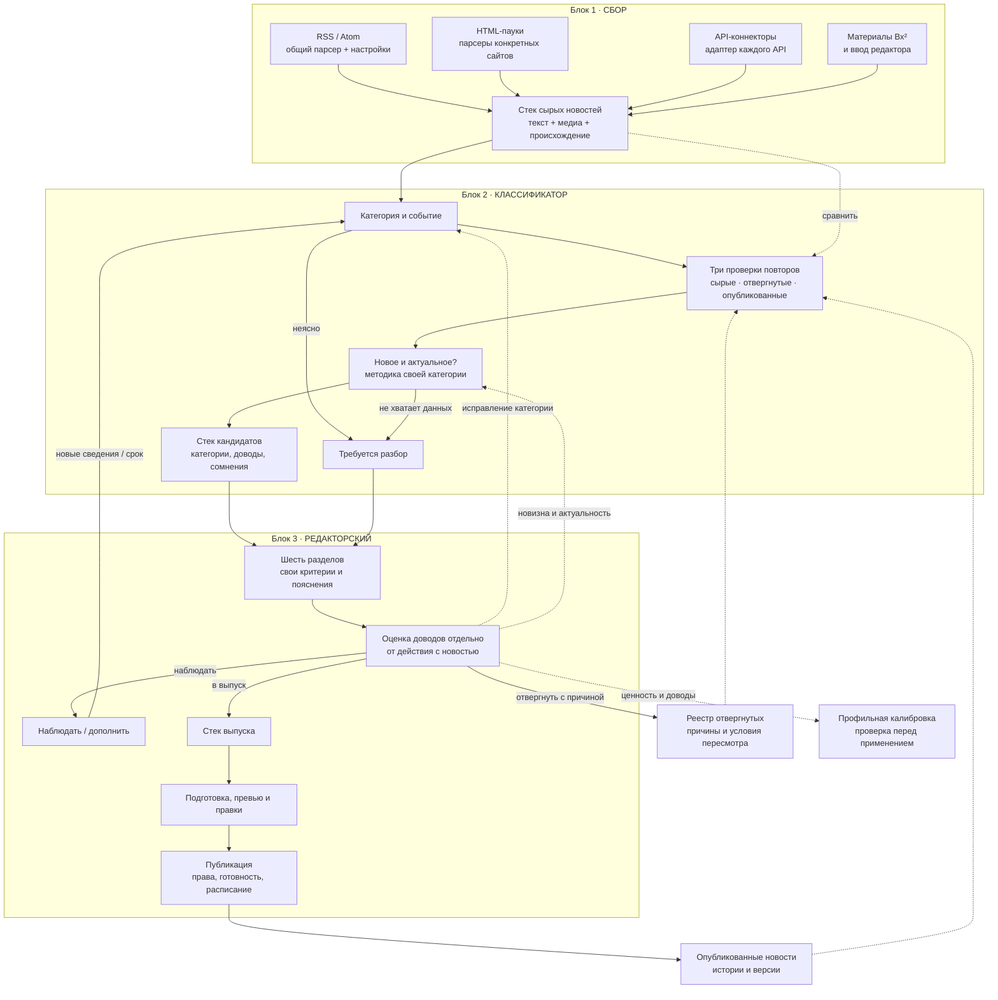

# Новости — три блока обработки

Пользователь уточнил целевой процесс: несколько пауков → исходные материалы с медиа → стек сырых новостей; классификатор с проверкой повторов в сырых, отвергнутых и опубликованных, актуальность по типам → стек кандидатов; редакторский блок по типам с содержательной обратной связью вместо обучения только на «ДА / НЕТ / В СТЕК».

Это действующее структурное уточнение схемы. Шесть категорий и их оформление сохраняются. Здесь «тип» означает категорию обработки, не новый entity_type. Алгоритмы, пороги, интерфейс и физическое хранение — проект. Новых таблиц, кроме ранее явно согласованных, эта страница не разрешает. Код, настройки, БД и сервер не изменены.

## Диаграмма

Три стека — разные стадии, не независимые копии новостей. Память отказов и публикаций общая для всех категорий. Неподходящие и повторные материалы не удаляются без следа: причина обработки сохраняется, хотя они не обязаны снова появляться среди кандидатов.

## 1. Сбор: пауки и сырые новости

**Несколько пауков действительно нужны**, но не каждый пишется с нуля. RSS/Atom имеет общий парсер; конкретная лента задаётся настройками. HTML требует правил или отдельного кода под разметку сайта. Для каждого API нужен свой адаптер. Один сайт может использовать RSS для обнаружения и собственный HTML-парсер для полной статьи и медиа. HTTP-клиент, ограничения источников, повторы запросов и журналы общие.

На выходе каждый адаптер формирует исходный материал одного формата:

- UID источника, внешний ID и canonical URL;
- заголовок, язык, анонс и доступный текст; признак полноты;
- отдельные даты публикации, обновления и получения; дата события при извлечении, неизвестное остаётся неизвестным;
- исходное содержимое и отпечаток, версия материала, происхождение извлечённых полей;
- массив медиа: изображения, видео, аудио, PDF и другие вложения.

Предлагаемый элемент медиа: вид, исходный адрес, подпись, автор/правообладатель и источник, лицензия при наличии, порядок, роль (обложка/иллюстрация/вложение), формат/размеры при наличии, статус получения. Если файл сохранён — UID медиа и контрольная сумма. Внешний URL не заменяет внутреннюю связь. Постер не считается скачанным видео. Отсутствующие сведения не выдумываются.

**Предложение реализации:** при сборе сохранять сведения обо всех найденных медиа и доступные изображения/вложения в пределах настроенных ограничений; крупные видео/аудио получать по необходимости. Политика объёма и сроков хранения ещё не определена. Ссылка не означает, что файл сохранён; ошибки текста и медиа видны отдельно. Авторские материалы и исправления сохраняются.

Сырые материалы фиксируются до LLM. Техническая идемпотентность записи предотвращает размножение одной и той же неизменной версии; содержательная проверка трёх корпусов — блок 2. Новое содержимое по старому URL сохраняется и обрабатывается как обновление. Сбой LLM не теряет входной материал.

## 2. Классификатор и стек кандидатов

Это блок из нескольких операций, не один промпт: классификация → три сравнения → методика новизны/актуальности категории → кандидат с основаниями. Классификатор не определяет редакторский вкус. Источник даёт контекст, содержание — основание категории; неоднозначность направляется на разбор.

| Корпус | Что сравниваем | Результат |
|---|---|---|
| Сырые новости | Документ, версии, перепечатки и публикации об одном событии | Повтор не создаёт новую историю; другой источник присоединяется; новые факты сохраняются |
| Отвергнутые | Историю, причину и обстоятельства отказа | Неизменный повтор не предъявляется как совершенно новый; существенное изменение допускает пересмотр |
| Опубликованные | Событие и уже известные факты | Пересказ не создаёт второй выпуск; новая стадия/существенное дополнение допускает продолжение или новую редакцию |

**Отказ не равен вечному запрету.** «Инструмент недоступен» может потерять силу после релиза; «приём закончился» не запрещает новость об итогах конкурса. У отказа сохраняются автор, дата, причина, версия рассматриваемой истории и условия пересмотра. Сходство тем не переносит отказ с одного события на другое.

Машинный отсев отделён от отказа редактора. Для него сохраняются причина и версия правил, но он не подаётся в обучение как человеческая оценка. Повторное создание уже существующего кандидата/элемента стека также исключается — это идемпотентность переходов, не четвёртый смысловой корпус.

Сверка проводится по всем категориям. Векторная близость находит кандидатов для сравнения, а не доказывает тождество событий. Одинаковый DOI помогает объединить работу из разных каталогов; DOI — внешний идентификатор, внутри связи по UID. Неясные совпадения требуют фактов или редакторского разбора.

Карточка кандидата: UID категории и истории, исходники и медиа, найденные совпадения, новые сведения, актуальность с основаниями, профильные доводы ценности, сомнения и недостаток данных. До включения в стек выпуска текст новости не обязателен.

## 3. Редакторский блок: шесть разделов

Одинаковые действия и согласованная инфографика, но свои критерии:

| Раздел | Актуальность и существенное новое — проект методики | Что проверяет редактор |
|---|---|---|
| Архитектура | Объект, стадия, дата события, новые чертежи/сведения | Новый объект или новый этап? Есть фактическая разница? Архитектурная ценность оценивается отдельно |
| ПО | Продукт, версия, доступность функции, совместимость, условия доступа | Функция доступна или обещана? Кому полезна? Что изменилось? |
| ИИ | Новая возможность, независимая проверка, ограничения и развитие истории | Прорыв или повтор анонса? Достаточны доказательства? Почему важно нашим читателям? |
| Конкурсы | Действующий приём, допуск, сроки, изменения этапов, итоги | Условия и дата верны? Доступно студентам? Что изменилось? |
| Материалы сайта | Содержательное опубликованное изменение и прежние анонсы | Достаточно нового для анонса или объединить изменения? |
| Исследования и знания | Результат, основания, версия, рецензирование/дискуссия, новый документ/атрибуция | Обоснован ли вывод? Что изменилось в понимании? Гипотеза, интерпретация и установленный факт различаются |

Искусствоведение, история дизайна, визуальная культура, наследие и реставрация входят в знания. Возраст произведения не равен возрасту исследования. Недавняя загрузка старой статьи не делает результат новым. Исследования ИИ относятся к ИИ.

### Действие и обратная связь разделены

**Действия:** в выпуск / наблюдать / отвергнуть / дополнить. Они управляют процессом, но сами по себе не подтверждают все доводы робота.

| Обратная связь | Что фиксируем | Что она улучшает |
|---|---|---|
| Исправление категории | Прежняя и верная категория, основание | Классификацию |
| Исправление совпадения | То же событие / другой этап / другое событие, сравниваемую историю | Поиск повторов |
| Оценка актуальности | Верный факт или исправление, дату/срок/версию | Методику актуальности категории |
| Оценка ценности | Конкретный довод, вердикт и пояснение | Профильную оценку |
| Насыщенность | Временную причину и связанные истории | Приоритет момента, не постоянный запрет темы |

Предложение карточки: «Что нового», «Почему актуально», «Почему стоит внимания», «Сомнения», «Совпадения». У довода — **верно / неверно / не оценено**, исправление факта и собственная причина. Кнопка «В выпуск» не превращает неоценённое в подтверждённое. Это отличается от нынешнего поведения «Да»; конкретный интерфейс ещё обсуждается.

Минимальный обучающий сигнал: кто и когда, версия материала и оценки, категория, критерий/довод, вердикт, исправление и причина. Это контракт обработки, а не разрешение новой таблицы. Прежние решения не переинтерпретируются задним числом.

В текущем проекте «обучение» — профиль, примеры в промпте и поправки правил, не автоматическое изменение весов нейросети. Изменения калибровки проверяются на отдельной отложенной выборке до включения. Неоценённые доводы не являются ни положительными, ни отрицательными примерами. Ошибка сбора или LLM не превращается в редакторское «нет».

## Термины и сохранность

- **Стек сырых новостей** — нормализованные исходные публикации с медиа, до оценок.
- **История** — событие и его развитие, объединяющее материалы нескольких источников.
- **Стек кандидатов** — истории после проверок, готовые к редакторскому рассмотрению по категориям.
- **Реестр отвергнутых** — память решений с причинами и основаниями пересмотра, не чёрный список тем.
- **Стек выпуска** — выбранные истории для подготовки и публикации.
- **Новость** — наша редакционная запись: черновик и опубликованные версии.

Это логические стадии, не перечень новых таблиц. Нынешнее 30-дневное окно pool не определяет срок хранения памяти отказов, опубликованных историй и редакторских решений. Политику исходников/медиа и памяти решений проектируем отдельно; решения редактора не удаляются вслед за временным пулом. Авторизация, аудит, BackUp и защита ручных правок обязательны с начала.

Внутренний сборщик реагирует на содержательные опубликованные изменения, не на каждое сохранение черновика. Созданные роботом новости исключаются из входных событий, чтобы не возникал бесконечный цикл анонсов.

## Уточнение плана реализации

Порядок работ из [плана внедрения](Новости%20—%20схема%20конвейера%20и%20план%20внедрения.md) сохраняется с уточнением:

1. Сверка сервера, сохранность, права, аудит, справочник категорий и проект хранения — до переключения.
2. **Блок 1:** адаптеры, текст и медиа, стек сырых, статусы получения. Проверка: повторный обход не создаёт дубль, изменённый материал обнаруживается, недоступное медиа не объявлено скачанным, сбой LLM не теряет сырьё.
3. **Блок 2:** классификация и три корпуса, причины отказов, методики категорий, стек кандидатов. Проверка: повтор отказа без изменений; пересмотр после нового факта; развитие опубликованной истории; отсутствие дубля уже ожидающего кандидата.
4. **Блок 3:** шесть разделов, отдельные действие и оценка доводов, наблюдение и выпуск. Проверка: «В выпуск» не подтверждает всё автоматически; отказ по давности не обучает неприятию темы; машинный отсев не выдаётся за мнение человека.
5. Сравнение на копии исходников без изменения рабочей очереди; включение по категориям после проверки. Исправления Н-01…Н-07 публикационного механизма не считаются выполненными самим разделением потоков.

Полный текст после выбора редактором остаётся предложением целевого процесса; отключение нынешней предварительной генерации лучших историй отдельно согласуется до изменения поведения. В блоках 1–2 получение исходного текста для проверки допускается раньше: это не генерация нашей новости.

Существующая таблица четырёх этапов интерфейсов не меняется. Ни новых источников, ни API, ни миграций эта итерация не подключает. Предыдущая диаграмма сохранена в [архиве](Архив/Новости%20—%20схема%20до%20трёх%20блоков%202026-11-09.md).
