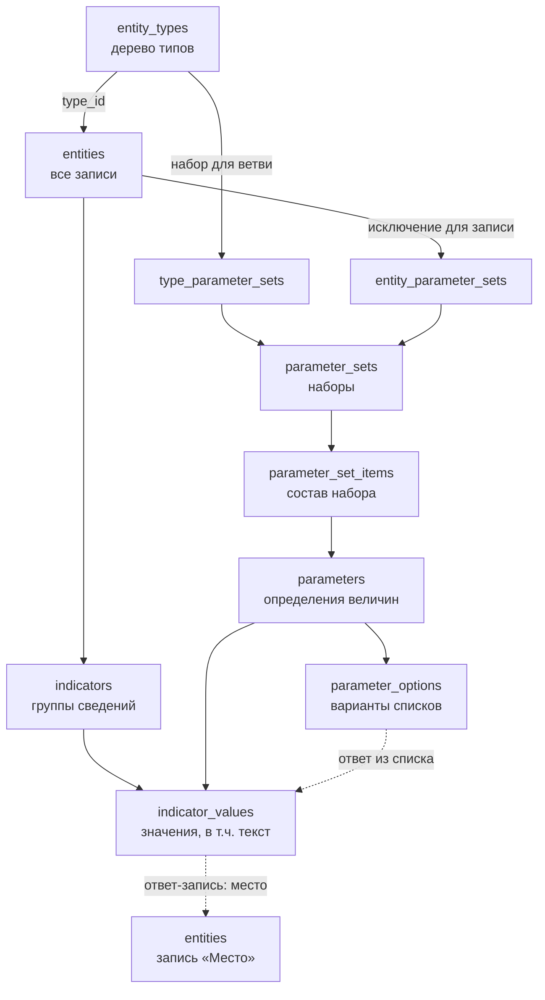
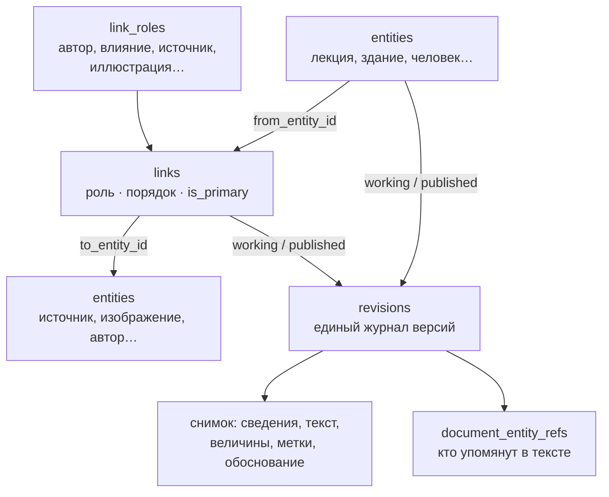
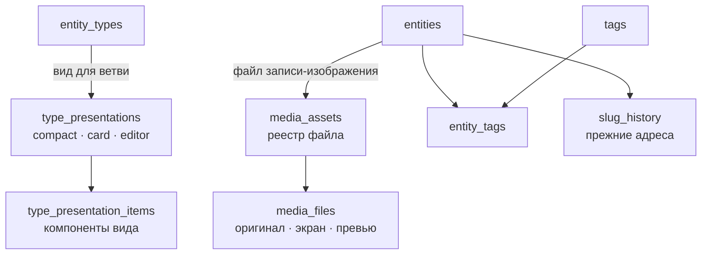

# Схема данных

**Единственный документ о схеме данных.** К этой модели идём и по ней строим код. Прежние описания — «Структура БД», ранняя «Схема данных», «Источники и отображения», снимок состояния на 2026-09-30 — лежат в [архиве](Архив/) как история рассуждений; при расхождении прав этот документ и [журнал решений](Решения.md).

Три основы — **запись, связь, параметр** — плюс версия и отображение. Всё, что раньше было отдельными механизмами (присоединения, источники, справочник мест, сведения о файле, самостоятельные тексты), выражено через них ([Р-39](Решения.md), [Р-76](Решения.md), [Р-78](Решения.md), [Р-80](Решения.md), [Р-84](Решения.md), [Р-85](Решения.md), [Р-86](Решения.md)).

**Состояние на 2026-10-01.** Хранение унифицировано миграцией `db/migrations/0026_one_model.sql` (рабочая база, 02:32 UTC); все три представления управляются таблицей отображений с миграции `0027_presentations_everywhere.sql` (02:48 UTC). После неё в схеме `app` 35 таблиц; прежних `attachments`, `targets`, `reference_items`, `places` больше нет.

## Диаграмма

Три части, каждая читается сверху вниз. Общий узел — `entities`.

### 1. Запись и её сведения

### 2. Связи и версии

### 3. Отображение и техническое хранилище

## Записи — `entities`

Одна таблица для **всего, о чём можно говорить и на что можно сослаться**. Различает тип из дерева `entity_types`; какие сведения у записи — решает набор параметров её ветви.

| Ветвь дерева | Типы | Что это |
|---|---|---|
| Кто | Человек, Компания, Группа | Авторы, бюро, коллективы |
| Что | Архитектурный объект, Градостроительная концепция, Конкурсная работа, Учебная работа, Постановка, Событие… | Предметы изучения |
| Что | Книга, Статья, Веб-страница | Источники: на них ссылаются тексты ([Р-80](Решения.md)) |
| Где | Место | Страна, город, адрес, точка на карте ([Р-85](Решения.md)) |
| Когда | Стили, эпохи, методы, учения | Периоды и течения |
| Материалы | Изображение, Документ | Файлы и самостоятельные тексты ([Р-84](Решения.md)) |
| Служебные | Лекция, Новость | Учебные тексты; новости сайта ([Новости](Новости.md), 0030) |
| Страницы проекта | Логотип, Философия, Манифест, Обратная связь | Раздел «О проекте» |

У каждой записи: название, слаг, тип, статус, указатели версий и сведения по набору параметров. Собственный текст — тоже сведение (ниже), если набор ветви его содержит: у лекции, здания, человека он есть, у места и изображения нет ([Р-86](Решения.md), уточняет [Р-77](Решения.md)).

Тип, опубликованность и попадание в общий каталог — разные характеристики. Изображения и документы опубликованы, но в общий каталог, разделы и карту сайта не попадают: их видно на странице записи, к которой они относятся.

## Сведения — параметры

| Таблица | Что хранит | Пример |
|---|---|---|
| `parameters` | Определение величины: смысл, единица, вид значения | «Пролёт, м», «Адрес страницы», «Автор снимка», «Текст» |
| `parameter_options` | Варианты для величины-списка | вид изображения: фото, план, разрез; точность места |
| `parameter_sets` + `parameter_set_items` | Наборы величин | «Зрелищное здание», «Место — сведения», «Изображение — сведения», «Текст» |
| `type_parameter_sets` | Какой набор действует для ветви (вниз по дереву) | «Веб-страница» → набор с адресом страницы |
| `entity_parameter_sets` | Исключение для одной записи | музей в бывшем вокзале получает «Вокзал» |
| `indicators` | Группа сведений записи | «по проекту», «после реконструкции», «Текст» |
| `indicator_values` | Сами значения; причина или оговорка — в `note` | пролёт = 43; адрес = запись-место; текст = блоки |

Виды значений: число, целое, текст, да/нет, вариант, дата, **запись** (`entity_value_id`, с назначенной ветвью — так ставится место), **блоки** (`blocks_value` — текст записи, BlockNote).

- **Текст записи** — параметр `text` вида «блоки». Версионируется вместе с записью: другой версии у него нет ([Р-86](Решения.md)).
- **Отношение к месту** — параметр той записи, что на место ссылается: «Адрес объекта», «Место рождения», «Захоронение», «Офис». Ответ — запись «Место»; причина — в `note`. Связь для этого не расширяется ([Р-85](Решения.md)).
- **Сведения о месте** — параметры записи «Место»: страна, населённый пункт, улица, дом, помещение, широта, долгота, точность, источник сведений.
- **Сведения о файле** — параметры записи «Изображение»: вид, автор, правообладатель, источник, подпись источника, место хранения, инв. номер, год, лицензия, описание для незрячих, описание.

## Связи — `links`

Любое отношение двух записей и любое **использование** одной записи другой. Связь не расширяется новыми полями под частный случай: то, что описывает саму запись, — её параметр.

| Поле | Значение |
|---|---|
| `from_entity_id`, `to_entity_id` | Обе стороны — записи |
| `role_id` → `link_roles` | Архитектор, автор, влияние, **источник**, **иллюстрация**… |
| `sort_order` | Порядок: например, изображений в галерее |
| `is_primary` | Главная связь своей роли; обложка записи — первая по порядку иллюстрация (Р-36) |
| обоснование | Принадлежит связи, физически хранится в её версии (`revisions`, снимок связи). Почему связь есть; для источника — «на стр. 34 сказано „…“»; для иллюстрации — подпись к этому месту |

| Было отдельным механизмом | Теперь |
|---|---|
| Автор здания, влияние, участие | связь с ролью |
| Источник цитаты (`reference_items`) | связь «источник» к Книге, Статье, Веб-странице; в тексте — знак `sourceRef` ([Р-80](Решения.md)) |
| Обоснование связи (документ на присоединении) | содержимое версии связи ([Р-78](Решения.md)) |
| Изображение в галерее, обложка (`attachments`) | связь «иллюстрация» к записи «Изображение»: порядок, `is_primary` ([Р-84](Решения.md)) |

## Версии — `revisions`

Единый журнал. Владелец версии — запись **или** связь (`entity_id` / `link_id`, ровно одно). Владелец хранит статус и два указателя: `working_revision_id` (в работе) и `published_revision_id` (видно всем).

- Снимок версии записи — название, слаг, сведения, все значения параметров (включая текст), метки; связи — её поля и обоснование. Снимок собирается из значений; ключ `body_json` в нём — проекция текста для чтения.
- Таблицы значений — рабочая редакция. Для опубликованного содержимого используются `app.read_entities`, `read_links`, `read_indicators`, `read_values`, `read_entity_tags`. Обычный PATCH сущности сохраняет рабочую редакцию, не меняя публичную. Специализированные маршруты медиа/мест сейчас могут сразу перепубликовывать её: это ограничение реализации, перечисленное в [API](API.md).
- Публикуется владелец целиком одной редакцией ([Р-79](Решения.md)); отдельной публикации текста нет. Сохранённая версия не переписывается. Связанные самостоятельные записи вместе с владельцем не публикуются.
- Авторство и рассмотрение — `materials`, `material_credits`, `revision_reviews`.

## Отображение — `type_presentations`, `type_presentation_items`

Как запись выглядит, задаёт её тип; берётся ближайшая настройка вверх по дереву, частичного слияния списков нет. `type_presentations` — пара «тип + режим» (`compact`, `card`, `editor`), `type_presentation_items` — компоненты по порядку, при необходимости с параметром.

| Режим | Где действует | Компоненты |
|---|---|---|
| **compact** | Упоминание в строке, карточка в тексте, каталог приложения, списки сайта — один вид разного размера. `app.compact_json(запись, черновики)` отдаёт компоненты с готовыми значениями | `thumbnail` / `portrait` — обложка и её форма, `mark` — знак источника, `parameter` — значение параметра (у места — город), `title`. Название показывается всегда. Здание, период, лекция — миниатюрой; человек — портретом; книга, статья, веб-страница — знаком; место — с городом |
| **card** | Страница записи: порядок разделов | `indicators`, `links`, `text`, `gallery`, `sources`, `mentions`, `citation` |
| **editor** | Форма редактора: разделы и порядок | `title` (тип, название, адрес, другие названия — есть всегда), `tags`, `indicators`, `gallery`, `text`. У места и изображения нет текста, у документа — сведений. Без раздела `text` форма текст не отправляет, и прежний сохраняется |

Ближайшая настройка вверх по дереву — `app.presentation_for(тип, режим)`. Каталог при этом сохраняет свои рамки: подпись типа, значение сортировки, статус. В режиме `compact` порядок компонентов в таблице задаёт только порядок параметров: разметка (`compactParts` сервера и клиента) сводит вид к картинке или знаку, названию и параметрам и ставит их в постоянном порядке; перестановка `title`, `mark`, `thumbnail` вид не меняет (проверка 2026-10-03).

Отображение не управляет правами и не решает, что попадает в каталог.

## Техническое хранилище — не модель, а склад

| Таблица | Что |
|---|---|
| `media_assets` | Реестр файла и ссылка на его запись «Изображение»; публичность — через запись |
| `media_files` | Физические варианты: оригинал, экранный, превью; контрольные суммы |
| `document_entity_refs` | Производный указатель: кто упомянут в какой версии текста |
| `documents` | Только история: прежние тексты с записанным хозяином (`owner_entity_id` / `owner_link_id`) и старые адреса |
| `slug_history` | Прежние адреса записи |
| `search_chunks` | Поисковый индекс (Р-109, 0033): куски записи — название, сведения, текст — из опубликованной и рабочей версии, `tsvector` и вектор pgvector. Производные данные, пересобираются из версий; [Поиск](Поиск.md) |
| `search_queries` | Журнал поисковых запросов (Р-113, 0037): запрос, участник или суточный псевдоним гостя, режим, число и верх выдачи. Служебный учёт, читает su |
| `ai_requests` | Журнал обращений к моделям ИИ (Р-113, 0037): назначение, модель, токены, стоимость, итог; ссылка на поисковый запрос. Служебный учёт, читает su |
| `tags`, `entity_tags` | Метки, в том числе у изображений |

## Служебное — авторство, права, импорт

| Таблицы | Что |
|---|---|
| `materials`, `material_credits`, `revision_reviews` | Авторские подписи и ход рассмотрения версий |
| `contributors`, `roles`, `permissions`, `role_permissions`, `user_roles`, `telegram_accounts` | Участники и права |
| `import_jobs`, `import_items`, `import_key_map` | Пакетный импорт; также журнал прогонов робота новостей |
| `news_sources` | **Принято, ещё не создано (Р-88).** Список источников робота новостей и состояние обхода — [Новости](Новости.md) |
| `schema_migrations` | Журнал миграций |

## Чего в модели больше нет

| Таблица | Чем заменена |
|---|---|
| `reference_items`, `reference_kinds` | связь «источник» к записи-источнику |
| `targets`, `attachments`, `attachment_roles` | связь; присоединяемое — запись |
| `media_kinds` | варианты параметра «Вид изображения» |
| `media_tags` | `entity_tags` записи-изображения |
| `places` | записи типа «Место»; прежние снимки находят их через `entities.legacy_place_id` |

Итог: восемь таблиц сняты, две таблицы отображений добавлены — **41 → 35 таблиц** в схеме `app`. Единственный механизм отношений — связь.

## Инварианты

- Внутренние ссылки — только по UID и номерам строк, не по кодам и названиям.
- У значения заполнено ровно одно поле ответа, и оно соответствует виду параметра; ответ-запись принадлежит назначенной ветви.
- У новой полной версии сущности/связи один непосредственный владелец; составные FK указателей запрещают чужую версию. Прежние версии документов/файлов могут иметь только material_id: они сохранены как история, не объявляются полными редакциями сущности.
- Опубликованная запись или связь всегда имеет опубликованную версию.
- Связь требует обоснования там, где этого требует роль.
- Данные, авторские подписи, история и права при переходах не теряются: прежние версии не переписываются.

## Правила физического хранения и чтения

1. **Рабочее состояние.** `entities`, `indicators`, `indicator_values`, `entity_tags` хранят редактируемые поля/значения. `links` хранит рабочие поля отношения. Снимок версии фиксирует содержимое; таблицы рабочих значений не заменяют исторический снимок.
2. **МультиТекст.** Определение `parameters.code=text` имеет вид blocks. Рабочие блоки лежат в `indicator_values.blocks_value`; `writeText` меняет это значение, `entity_snapshot` собирает снимок и проекцию `body_json`. Пропущенное body_json не трогает текст. Текст не отправляется одновременно как обычный показатель. У версии связи body_json — её основание, не текст источника.
3. **Версии.** `revisions` хранит `snapshot`, `base_revision_id`, `edited_by`, `created_at`, `schema_version` и UID владельца. Триггер запрещает UPDATE значимых полей сохранённой версии. Указатели working/published принадлежат entities/links. `schema_version=2` — полная версия; прежние частичные остаются историей. Архивирование скрывает владельца, не является физическим удалением истории.
4. **Публикация.** Статусы draft/published/archived принадлежат владельцу; published требует указателя на его версию. `is_published` у entities — производный флаг. `materials.status` не является источником публичности сущности/связи. Повторное опубликование старого полного снимка не заменяет текущую рабочую редакцию. Ссылки на самостоятельные записи не копируют их содержимое и не публикуют их автоматически.
5. **Ответы параметров.** FK значений — UUID определения и группы; вариант — option_id, объект — entity_value_id. Тип/допустимая ветвь проверяются БД. Поля даты образуют один ответ; неизвестные части остаются NULL. Значение параметра и единица измерения не дублируются: единица у определения. `indicators.source_entity_id` — запись-источник группы, note — пояснение.
6. **Места.** Новое значение места — ID entities. `entities.legacy_place_id` только разрешает прежние UUID из неизменённых исторических снимков. Не писать новые данные через старую таблицу places — её нет.
7. **Файлы.** Оригинал/варианты — байты в медиахранилище; media_assets связывает UUID файла с сущностью-изображением, media_files хранит ключ, размер, SHA-256, MIME, геометрию, рецепт и состояние варианта. `assetId` в блоке — UUID файла, не URL и не ID сущности. Сведения об изображении — параметры сущности. Иллюстрация у другой записи — links с ролью illustration.
8. **Совместимость.** documents сохраняет прежние строки, владельцев и старые ID; это не второй активный механизм текста. material_id сохраняет авторские подписи/рассмотрения и старые интеграции. Нельзя удалять documents/materials только потому, что новые тексты туда не записываются: на них ссылается история. В коде ещё остаётся неподдерживаемая ветвь правки документа без владельца.
9. **Производные данные.** document_entity_refs — указатель вхождений в конкретной версии; он не заменяет blocks и не является смысловой связью links. body_text/search_vector в documents относятся к прежним текстам. Нового публичного полнотекстового поиска по всем версиям нет.
10. **Снимки не копируют весь граф.** Ссылки на места, словари, источники и медиа остаются UID. Версия своей записи не означает замороженную копию всех связанных объектов. Авторство хранится отдельно в material_credits, эффективные права — в ролях; ни авторство, ни тип представления не дают право публикации.
11. **Служебное.** Изменения API выполняются транзакциями с app.contributor_id для аудита. Это не полный журнал каждого SQL-изменения всех таблиц. schema_migrations фиксирует SQL-файлы/контрольные суммы; отдельный журнал Git-коммитов и выкладок в БД пока проектируется. Проект change_set_id не следует принимать за реализованный журнал.
12. **Сохранность.** Ни очистка кода, ни архив WIKI не разрешают удалять пользовательские данные. Перед миграцией — согласованная копия БД, оригиналов, конфигурации и ролей; порядок и пределы проверок в [BackUp](BackUp.md).

## Физический состав app после 0027

Сверено с information_schema рабочей БД 2026-10-01: **35 таблиц**. Это справочник колонок внутри единой схемы, не новая альтернативная модель. PK/FK/UNIQUE/CHECK, индексы и триггеры задаются [версионируемыми миграциями](../db/migrations/); править уже применённые файлы нельзя. bigint указан как int8, integer — int4, smallint — int2 (имена PostgreSQL). Служебные created/updated/by поля не заменяют полный журнал событий.

| Таблица | Колонки: тип PostgreSQL |
|---|---|
| `ai_requests` | `id: uuid`, `created_at: timestamptz`, `contributor_id: uuid`, `visitor_key: text`, `search_query_id: uuid`, `purpose: text`, `provider: text`, `model: text`, `items: int4`, `input_tokens: int4`, `output_tokens: int4`, `total_tokens: int4`, `cost_rub: numeric`, `usage: jsonb`, `status: text`, `error: text`, `output: text`, `duration_ms: int4`, `request_id: text` — **после 0037, ещё не применена** |
| `contributors` | `id: uuid`, `auth_uid: uuid`, `display_name: text`, `status: text`, `created_at: timestamptz`, `updated_at: timestamptz` |
| `document_entity_refs` | `revision_id: uuid`, `occurrence_id: text`, `block_id: text`, `entity_id: int8`, `pinned_revision_id: uuid`, `display_mode: text`, `target_block_id: text`, `media_asset_id: uuid`, `note: text`, `ordinal: int4` |
| `documents` | `id: int8`, `title: text`, `lang: text`, `body_format: text`, `body_schema_version: int4`, `body_json: jsonb`, `body_text: text`, `search_vector: tsvector`, `created_at: timestamptz`, `updated_at: timestamptz`, `created_by: uuid`, `updated_by: uuid`, `owner_entity_id: int8`, `owner_link_id: int8` |
| `entities` | `id: int8`, `slug: text`, `title_ru: text`, `title_original: text`, `original_language: text`, `title_la: text`, `title_en: text`, `is_published: bool`, `sort_order: int4`, `color: text`, `created_at: timestamptz`, `updated_at: timestamptz`, `created_by: uuid`, `updated_by: uuid`, `type_id: uuid`, `status: text`, `published_revision_id: uuid`, `working_revision_id: uuid`, `legacy_description_id: int8`, `legacy_place_id: uuid` |
| `entity_parameter_sets` | `entity_id: int8`, `set_id: uuid` |
| `entity_tags` | `entity_id: int8`, `tag_id: uuid` |
| `entity_types` | `id: uuid`, `parent_id: uuid`, `code: text`, `title_ru: text`, `sort_order: int4` |
| `import_items` | `id: uuid`, `job_id: uuid`, `local_key: text`, `external_key: text`, `item_kind: text`, `plan: text`, `status: text`, `material_id: uuid`, `error_code: text`, `error_detail: text`, `attempts: int4` |
| `import_jobs` | `id: uuid`, `source_namespace: text`, `manifest_version: text`, `payload_sha256: text`, `idempotency_key: text`, `status: text`, `started_by: uuid`, `started_at: timestamptz`, `finished_at: timestamptz`, `error_summary: text` |
| `import_key_map` | `source_namespace: text`, `external_key: text`, `material_id: uuid`, `first_imported_at: timestamptz` |
| `indicator_values` | `id: uuid`, `indicator_id: uuid`, `parameter_id: uuid`, `num_value: numeric`, `text_value: text`, `bool_value: bool`, `option_id: uuid`, `date_start_year: int4`, `date_start_month: int2`, `date_start_day: int2`, `date_end_year: int4`, `date_end_month: int2`, `date_end_day: int2`, `is_approximate: bool`, `is_ongoing: bool`, `note: text`, `sort_order: int4`, `entity_value_id: int8`, `blocks_value: jsonb` |
| `indicators` | `id: uuid`, `entity_id: int8`, `title: text`, `is_current: bool`, `measured_year: int4`, `measured_by: text`, `note: text`, `sort_order: int4`, `created_at: timestamptz`, `updated_at: timestamptz`, `created_by: uuid`, `updated_by: uuid`, `source_entity_id: int8` |
| `link_roles` | `id: uuid`, `code: text`, `title_ru: text`, `sort_order: int4` |
| `links` | `id: int8`, `from_entity_id: int8`, `to_entity_id: int8`, `role_id: uuid`, `note: text`, `sort_order: int4`, `is_primary: bool`, `confidence: text`, `created_at: timestamptz`, `updated_at: timestamptz`, `created_by: uuid`, `updated_by: uuid`, `status: text`, `published_revision_id: uuid`, `working_revision_id: uuid` |
| `material_credits` | `material_id: uuid`, `contributor_id: uuid`, `credit_role: text` |
| `materials` | `id: uuid`, `status: text`, `kind: text`, `entity_id: int8`, `link_id: int8`, `document_id: int8`, `asset_id: uuid`, `published_revision_id: uuid`, `archived_at: timestamptz`, `created_at: timestamptz`, `updated_at: timestamptz`, `created_by: uuid` |
| `media_assets` | `id: uuid`, `asset_class: text`, `created_at: timestamptz`, `updated_at: timestamptz`, `created_by: uuid`, `updated_by: uuid`, `archived_at: timestamptz`, `entity_id: int8` |
| `media_files` | `id: uuid`, `asset_id: uuid`, `variant: text`, `source_file_id: uuid`, `storage_backend: text`, `storage_key: text`, `original_name: text`, `mime_type: text`, `size_bytes: int8`, `width: int4`, `height: int4`, `sha256: text`, `status: text`, `recipe_version: text`, `transform_params: jsonb`, `is_current: bool`, `error_code: text`, `created_at: timestamptz`, `generated_at: timestamptz` |
| `parameter_options` | `id: uuid`, `parameter_id: uuid`, `code: text`, `title_ru: text`, `sort_order: int4` |
| `parameter_set_items` | `set_id: uuid`, `parameter_id: uuid`, `sort_order: int4`, `hint: text` |
| `parameter_sets` | `id: uuid`, `code: text`, `title_ru: text`, `note: text`, `sort_order: int4` |
| `parameters` | `id: uuid`, `code: text`, `title_ru: text`, `unit: text`, `value_type: text`, `definition: text`, `sort_order: int4`, `created_at: timestamptz`, `updated_at: timestamptz`, `created_by: uuid`, `updated_by: uuid`, `is_repeatable: bool`, `value_entity_type_id: uuid` |
| `permissions` | `id: uuid`, `resource: text`, `action: text`, `description: text` |
| `revision_reviews` | `id: uuid`, `revision_id: uuid`, `reviewer_id: uuid`, `decision: text`, `note: text`, `created_at: timestamptz` |
| `revisions` | `id: uuid`, `material_id: uuid`, `base_revision_id: uuid`, `edited_by: uuid`, `operation: text`, `summary: text`, `snapshot: jsonb`, `schema_version: int4`, `change_set_id: uuid`, `created_at: timestamptz`, `entity_id: int8`, `link_id: int8` |
| `role_permissions` | `role_id: uuid`, `permission_id: uuid` |
| `roles` | `id: uuid`, `code: text`, `title: text`, `sort_order: int4` |
| `schema_migrations` | `number: int4`, `filename: text`, `checksum: text`, `applied_at: timestamptz`, `applied_by: text`, `duration_ms: int4` |
| `search_chunks` | `id: uuid`, `entity_id: int8`, `revision_id: uuid`, `scope: text`, `kind: text`, `chunk_no: int4`, `block_id: text`, `content: text`, `content_sha256: text`, `tsv: tsvector` (вычисляемая), `model: text`, `embedding: vector(1536)`, `created_at: timestamptz`, `embedded_at: timestamptz` — с 0033 (2026-10-05) |
| `search_queries` | `id: uuid`, `created_at: timestamptz`, `updated_at: timestamptz`, `contributor_id: uuid`, `visitor_key: text`, `query: text`, `kinds: text[]`, `type_code: text`, `mode: text`, `results_count: int4`, `exact: bool`, `top: jsonb`, `duration_ms: int4`, `request_id: text` — **после 0037, ещё не применена** |
| `slug_history` | `slug: text`, `entity_id: int8`, `changed_at: timestamptz` |
| `tags` | `id: uuid`, `title: text`, `created_at: timestamptz`, `created_by: uuid` |
| `telegram_accounts` | `telegram_user_id: int8`, `contributor_id: uuid`, `verified_at: timestamptz` |
| `type_parameter_sets` | `type_id: uuid`, `set_id: uuid` |
| `type_presentation_items` | `id: uuid`, `presentation_id: uuid`, `component: text`, `sort_order: int4`, `settings: jsonb`, `parameter_id: uuid`, `link_role_id: uuid` |
| `type_presentations` | `id: uuid`, `type_id: uuid`, `mode: text`, `settings: jsonb`, `created_at: timestamptz`, `updated_at: timestamptz`, `created_by: uuid`, `updated_by: uuid` |
| `user_roles` | `id: uuid`, `contributor_id: uuid`, `role_id: uuid`, `granted_by: uuid`, `granted_at: timestamptz`, `revoked_at: timestamptz` |
