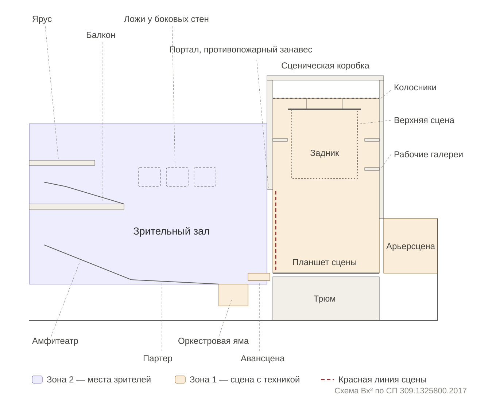

# Термины сцены и зала

Схема: `assets/theatre-section-sp309.svg` (вектор) и `assets/theatre-section-sp309.png` (1360 × 1090). Цветом — зоны [классификатора](Классификатор%20помещений.md): сиреневый — зона 2, места зрителей; песочный — зона 1, сцена с техникой.

Основа — раздел 3 «Термины и определения» СП 309.1325800.2017 «Здания театрально-зрелищные. Правила проектирования» (текст: [meganorm.ru](https://meganorm.ru/Data2/1/4293739/4293739242.htm)); в скобках — номер пункта. Определения пересказаны близко к тексту. Термины без номера в СП не определены — это общеупотребительные театральные слова, пояснения ассистента. Порядок — от сцены к залу и фойе, как в [классификаторе помещений](Классификатор%20помещений.md).

## Сцена (зона 1)

**Сценическая коробка** (3.13) — многоуровневый объём, отделённый от зала стеной с портальным проёмом. Включает колосники и рабочие галереи, планшет, трюм, арьерсцену и боковые карманы, если они есть. Основной тип традиционной сцены — **глубинная колосниковая сцена** (3.31): собственно сцена, авансцена, сценическая коробка и, возможно, арьерсцена.

По горизонтали, от зала вглубь:

| Термин | Что это |
|---|---|
| Оркестровая яма (3.37) | Открытое сверху углублённое помещение перед авансценой для оркестра и дирижёра. В оперных театрах обычно на подъёмно-опускной площадке |
| Рампа (3.23) | Светильники по переднему краю авансцены, укрытые от зрителей |
| Авансцена, просцениум (3.1) | Часть сцены, выдвинутая в зал не меньше чем на 1,5 м, шириной в портальную арку: от красной линии до рампы |
| Портал (3.21) | Проём в стене между сценой и залом, «зеркало сцены». Игровой портал (3.22) — его часть, суженная передними кулисами |
| Красная линия сцены (3.16) | Граница сцены и авансцены по внутренней плоскости портальной стены; обычно совпадает с противопожарным занавесом |
| Противопожарный занавес | Опускается в портал и делает сцену и зал разными пожарными отсеками. Отдельного пункта в разделе 3 нет |
| Основная игровая площадка (3.25) | Часть сцены от красной линии до арьерсцены |
| Планшет сцены (3.20) | Пол основной игровой площадки; бывает из съёмных щитов и люков-провалов |
| Карманы сценические (3.10) | Пространства сбоку от видимой части сцены, за боковыми стенами коробки, на уровне планшета: для быстрой смены декораций и накопления артистов |
| Арьерсцена (3.4) | Пространство позади основной игровой площадки, не отгороженное капитальными стенами |
| Рирпроекционная (3.26) | Помещение за сценой или арьерсценой для проекции декораций на просвет |

По вертикали:

| Термин | Что это |
|---|---|
| Колосники (3.12) | Решётчатый настил над сценой: через него идут тросы от штанкетов к блокам. Вся система поднимает и опускает декорации, свет и подъёмные занавесы |
| Штанкет | Подвесная штанга, на которой висят занавес, декорация или свет; поднимается тросами через колосники |
| Верхняя сцена (3.30) | Часть сценической коробки выше зеркала сцены, до колосников: навесные декорации, верхний свет, механизмы. Сюда поднимают задник целиком, и отсюда высота башни над сценой |
| Рабочие галереи (3.9) | Галереи по боковым и задней стенам сцены для рабочих сцены, осветителей, механизмов и пультов |
| Трюм, нижняя сцена (3.32) | Помещение под сценой для нижней механики, подъёмно-опускных устройств и эффектов; бывает в несколько этажей — первый трюм, второй и т. д. |
| Сейф скатанных декораций (3.29) | Склад мягких фоновых декораций под сценой или арьерсценой |
| Кулисы | Боковые полосы ткани или щиты, закрывающие от зрителя боковые части сцены; передние кулисы сужают портал до игрового (3.22) |
| Закулисье | Разговорное: всё, что за порталом и не видно зрителю, — карманы, арьерсцена, гримёрные, цеха. В СП не определено |

Для концертного зала — **эстрада** (3.36): сценическое пространство без портала и кулис, без быстрой смены подвесных декораций; может иметь занавес и малую сценическую коробку.

## Зрительный зал (зона 2)

| Термин | Что это |
|---|---|
| Партер (3.24) | Основная зона зала на плоском или слегка наклонном полу |
| Амфитеатр (3.2) | Места на ступенях, поднимающихся к периферии. Обычно за партером; бывает сбоку, сразу от сцены или ямы, а также на балконах |
| Балкон (3.5) | Зона над амфитеатром напротив сцены и по боковым сторонам зала, в несколько вертикальных рядов — ярусов |
| Ярус | Один уровень балконов и лож. Названия ярусов в театре — бенуар (ложи на уровне партера или чуть выше), бельэтаж (первый ярус над бенуаром), далее первый, второй ярус; верхний ярус по-старому — галёрка, раёк. В СП не определены |
| Ложи (3.17) | Обособленные зоны зала по сторонам партера, сзади него и на ярусах |
| Кулуар (3.15) | Промежуточное пространство у зала, ведущее в разные части зала и в ложи из фойе, буфета или вестибюля |

## Зритель вне зала (зона 3)

| Термин | Что это |
|---|---|
| Вестибюль кассовый (3.7) | Кассы и афиши |
| Вестибюль входной (3.6) | Принимает поток зрителей при входе |
| Вестибюль распределительный (3.8) | За входным; разводит встречные и пересекающиеся потоки |
| Фойе (3.34) | Для ожидания спектакля и отдыха в антракте |

## Исполнители и техника (зоны 4 и 9)

| Термин | Зона | Что это |
|---|---|---|
| Уборная артистическая (3.33) | 4 | Переодевание, грим, подготовка и отдых артистов; в обиходе — гримёрная |
| Костюмерная (3.14) | 4 | Подготовка костюмов к выходу: мелкий ремонт, глажка |
| Фойе оркестра (3.35) | 4 | Ожидание оркестрантов и проход к месту выступления |
| Аппаратная (3.3) | 9, ТХ | Управление светом, связью, звуком, кинотехникой, механизмами сцены |
| Светоаппаратная (3.27) | 9, ТХ | Пульт и аппаратура управления светом |
| Светопроекционная (3.28) | 9, ТХ | Прожекторы и проекционные аппараты |
| Кинопроекционная (3.11) | 9, ТХ | Стационарные кинопроекторы |

Кинотеатры по числу залов: **мультиплекс** (3.19) — 3–5 залов, **мегаплекс** (3.18) — 6 и больше.

## Иллюстрации

- Своя схема Вх²: продольный разрез театра с глубинной колосниковой сценой, подписи по этому справочнику — в начале страницы. На сайт пока не выложена.
- В базе: продольный разрез НОВАТ — изображение 656 у записи 38; план второго этажа — 653.
- В материалах Тайбэя: технические паспорта Большого театра, Blue Box и Globe Playhouse с разрезами сцен — `research_notes/Материалы для программы Тайбэйского центра/files/technical/`.
- В заданиях из папки `PDF/`: планы Комише-опер, план первого этажа оперы в Осло с зонами (брошюра Statsbygg).
